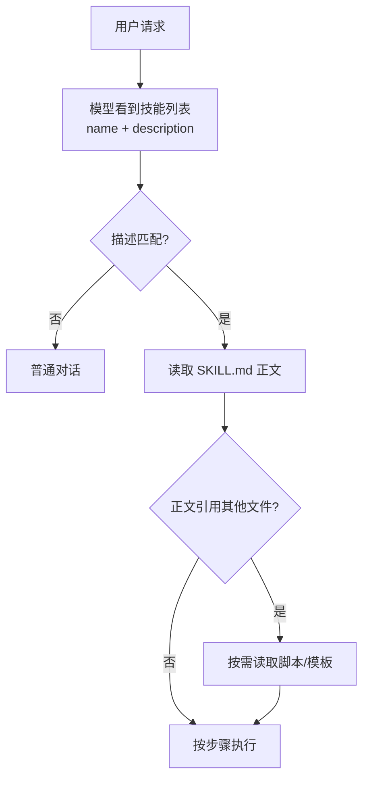

# AI Agent Skills 入门：从概念到可运行的技能包

同一个模型，在网页里问「怎么提交代码」只会给你三条 git 命令；在 Claude Code 里说「帮我提交」，它会先 `git status`、读 diff、翻项目的提交历史学风格，再写好 message 问你确认。差别不在模型权重，而在工作目录里那份 `SKILL.md`。

下面讲 Skills 与工具、MCP 的分工，SKILL.md 的结构和加载机制，两个能直接跑的示例，以及调试和踩坑的经验。

## 结论先行

- **Skills 是给模型的说明书**，用 Markdown 写，不需要改代码、不需要训练，放进目录就生效
- **加载是分级的**：平时只占几十个 token 的名称和描述，命中任务才读正文，需要时才读附带脚本
- **一个 Skill 一个目录**，`SKILL.md` 必须有 `name` 和 `description`，其余文件按需引用
- **写不好通常是描述写坏了**：`description` 决定它会不会被触发，正文决定触发后做得对不对

## 一、概念：三层能力的分工

模型自身能做的是推理和生成文本。要让它「会做」，需要三样东西配合：

| 层 | 负责 |
|---|---|
| 工具调用 | 提供原子动作，如读文件、跑命令 |
| MCP | 把外部系统接进来，统一协议 |
| Skills | 教模型怎么组合动作完成一件事 |

工具是手，MCP 是接口，Skills 是操作手册。缺手册时，模型面对 `bash` 工具只能即兴发挥，同一个任务每次走的路都不一样；有了手册，流程固定下来，结果可复现。

具体到「提交代码」这个任务：

```
没有 Skill：
  模型 → 建议三条命令 → 用户手动执行

有 Skill：
  git status → git diff → 读 git log 学风格
  → 生成 message → 用户确认 → git add + git commit
```

差别在于知识写在文件里，而不是每次靠提示词临时拼。

## 二、为什么用文件而不是塞进系统提示

系统提示每轮都要发送，一个复杂流程的说明动辄上千 token，常驻成本高，而且十个流程叠在一起会互相干扰。

Skills 用「按需读取」解决这个问题：

| 阶段 | 载入内容 | 大致成本 |
|---|---|---|
| 启动 | 所有技能的名称 + 描述 | 每个约数十 token |
| 命中任务 | 该技能的 `SKILL.md` 正文 | 数千 token |
| 执行需要时 | 附带的脚本、模板、参考文档 | 按文件读取 |

这样一来，装二十个技能也不会把上下文撑爆，只有真正用到的那个才展开。代价是多一次文件读取的往返，以及模型必须能根据描述判断「该不该用」。

## 三、加载流程



描述写清楚「什么时候用」，决定 C 这一步的判断；正文写清楚「怎么做」，决定 H 的质量。两者都不需要特殊语法，就是自然语言加必要的命令示例。

## 四、写第一个 Skill

目录结构：

```
~/.claude/skills/
└── commit-helper/
    ├── SKILL.md          # 必需
    ├── scripts/          # 可选：脚本
    └── references/       # 可选：长文档
```

`SKILL.md` 由 frontmatter 和正文组成：

```markdown
---
name: commit-helper
description: 按项目规范生成 commit message 并提交。当用户要求提交代码、
  整理改动、写提交信息时使用。
---

# 提交代码

## 流程

1. `git status` 确认改动范围，有未跟踪文件先问是否加入
2. `git diff` 读具体改动，按文件归纳意图
3. `git log --oneline -10` 看历史风格，跟随现有前缀习惯
4. 生成 message 给用户确认，确认后才执行 `git add` 和 `git commit`

## 约束

- 不执行 `git push`，除非用户明确要求
- 不提交 `.env`、密钥文件、大体积二进制
- 一次提交只做一件事，改动混杂时先拆分

## 示例

输入：修改了登录校验和两个测试文件
输出：`fix(auth): 修正 token 过期判断`
```

要点：

- `name` 用小写加连字符，和目录名一致
- `description` 写触发条件，包含用户可能说的原话，长度控制在几百字内
- 正文用祈使句写步骤，附一条输入输出示例，比形容词有效
- 需要限制工具时，用 `allowed-tools` 声明，比如只允许 `Bash(git:*)`、`Read`

项目级技能放在仓库的 `.claude/skills/` 下，跟着代码一起提交，团队共享；个人技能放 `~/.claude/skills/`，跨项目可用。

## 五、实战：天气查询技能

带脚本的技能更好说明「按需读取」的价值：

```
weather-helper/
├── SKILL.md
└── scripts/
    └── weather.py
```

```python
# scripts/weather.py
import json, os, sys, urllib.parse, urllib.request

city = sys.argv[1]
key = os.environ["OPENWEATHER_API_KEY"]
q = urllib.parse.quote(city)
url = (f"https://api.openweathermap.org/data/2.5/weather"
       f"?q={q}&appid={key}&units=metric&lang=zh_cn")
with urllib.request.urlopen(url, timeout=10) as r:
    d = json.load(r)
print(json.dumps({
    "city": d["name"],
    "temp": d["main"]["temp"],
    "feels": d["main"]["feels_like"],
    "desc": d["weather"][0]["description"],
    "humidity": d["main"]["humidity"],
}, ensure_ascii=False))
```

```markdown
---
name: weather-helper
description: 查询指定城市的实时天气与体感温度。用户问天气、气温、
  要不要带伞、穿什么衣服时使用。
allowed-tools: Bash(python3:*), Read
---

# 天气查询

## 步骤

1. 从用户消息中取城市名；没有则问，不要猜
2. 运行 `python3 scripts/weather.py "<城市>"`
3. 脚本返回 JSON：temp 温度、feels 体感、desc 描述、humidity 湿度
4. 用一句话给结论，再补穿衣或带伞建议

## 异常处理

- 退出码非 0：读 stderr，区分「城市不存在」与「Key 无效」
- 超时：重试一次，仍失败则告知用户接口不可用，不要编造天气
```

`description` 里写「带伞」「穿什么衣服」，是因为用户真的会这么问；只写「查询天气」会漏掉这些说法。

## 六、调试

```bash
# 1. 结构检查：目录里必须有 SKILL.md
ls -R ~/.claude/skills/weather-helper

# 2. 脚本单独跑通，再交给模型
OPENWEATHER_API_KEY=xxx python3 scripts/weather.py 杭州
```

排查顺序：

1. **没触发** → 把用户原话加进 `description`，重启会话让技能列表重新扫描
2. **触发了但步骤跑偏** → 正文步骤写得不具体，补命令和判定条件
3. **报错** → 先手动执行脚本，确认是脚本问题还是调用方式问题
4. **输出啰嗦** → 在正文里规定输出格式和长度

技能文件改动后要重启会话才重新加载，这一条最容易忘。

## 七、设计原则

| 原则 | 说明 |
|---|---|
| 单一职责 | 一个技能只做一件事，混合流程拆开 |
| 描述具体 | 写用户会说的原话，不写抽象目标 |
| 步骤可执行 | 每步对应一条命令或一个明确判断 |
| 示例优先 | 一条输入输出示例胜过三段说明 |

## 八、常见坑

- **把整个项目文档塞进 SKILL.md**：正文过长会挤占上下文，长文档放 `references/`，正文只留索引和关键结论
- **描述写成功能介绍**：`description` 是给模型做路由判断用的，触发词比形容词重要
- **脚本没有错误处理**：网络失败、Key 缺失都要有明确提示，否则模型会自己编结果
- **权限给太宽**：`allowed-tools` 只给这个流程必需的，能用 `Read` 就别给 `Bash`
- **同名技能分散在多个目录**：项目级与个人级重名时行为不确定，改名前先确认加载优先级
- **忘了版本化**：`~/.claude/skills/` 也该进 git，换机器不用重写

## 九、获取与分享

现成技能先看官方仓库和社区合集，安装方式通常是把目录拷到 `~/.claude/skills/`：

```bash
git clone https://github.com/user/awesome-skills.git
cp -r awesome-skills/<skill-name> ~/.claude/skills/
```

自己写的技能按下面结构发布，别人拷目录即可用：

```markdown
# SKILL.md frontmatter 至少包含
name: my-skill
description: 做什么 + 什么时候用
```

README 里补三段：依赖、配置项（环境变量）、一个最小示例。许可证按需加，MIT 最常见。

## 参考

- [Claude Code 文档](https://docs.anthropic.com)
- [Anthropic：Agent Skills 介绍](https://www.anthropic.com/news/agent-skills)
- [Model Context Protocol](https://modelcontextprotocol.io)
- [MCP 官方服务器列表](https://github.com/modelcontextprotocol/servers)
