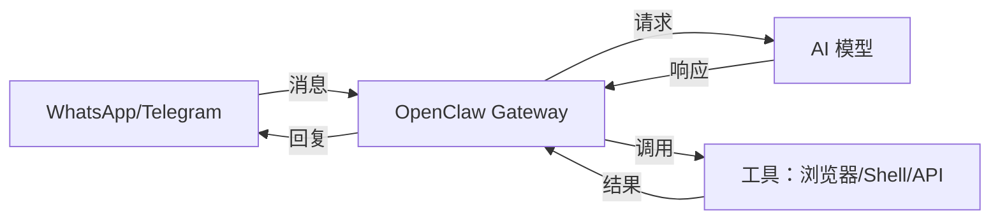
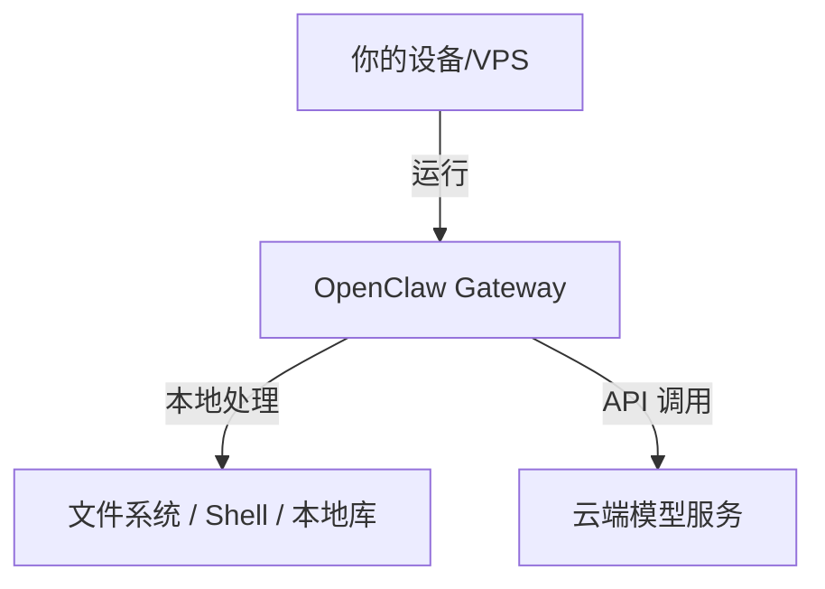
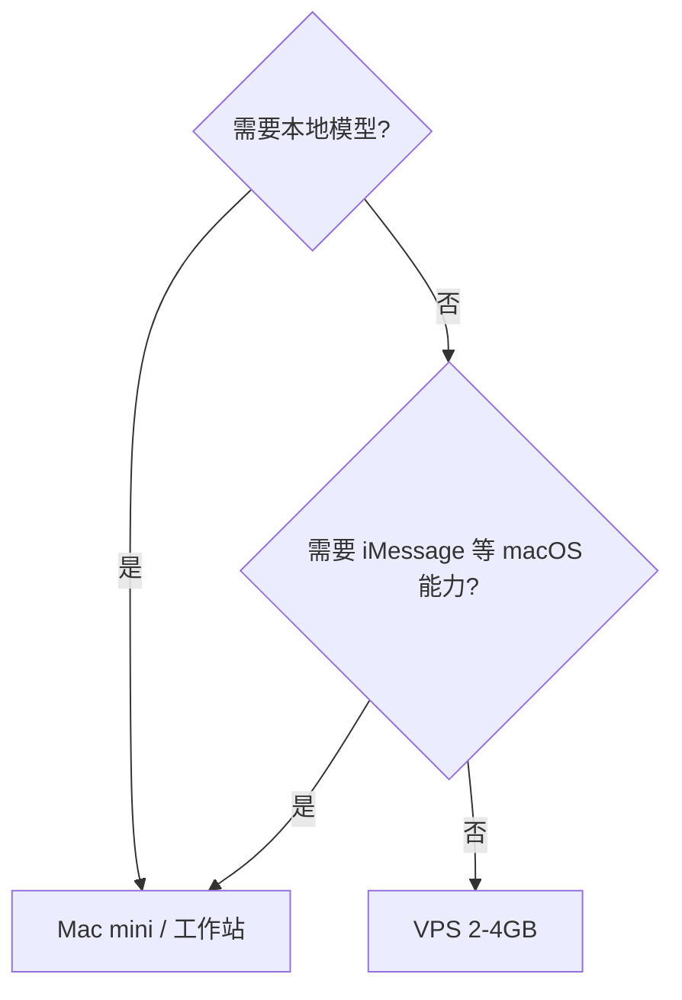

# OpenClaw 开源 AI 助理部署指南

在手机上发一句「把桌面收拾一下」，服务器上的机器真的去执行，结果再回到聊天窗口——这是 OpenClaw 的目标形态。它是一个自托管的消息优先助理，网关进程跑在你的机器上，记忆存成本地 Markdown 文件，模型调用走你自己配的 API Key。

下面依次讲架构、记忆结构、平台接入、安装配置、常驻与调度、硬件选型，以及权限该怎么收。

## 先确定三条判断

1. **没有云端控制面**：所有逻辑在本机进程里，机器关机它就下线
2. **硬件看要不要本地模型**：只走 API 的话 2C2G 的 VPS 够用，本地推理才需要 Mac mini 这类硬件
3. **它拿的是你账号的权限**：先隔离再上功能，第一次部署不要放在有生产数据的主机

## 一、它解决什么问题

网页版对话产品需要你主动打开、主动提问，对话结束上下文就没了。把助理放进消息应用能改变两件事：

- **入口**：不用切应用，Telegram/WhatsApp 里直接说，语音消息也能转文字
- **主动性**：网关按 cron 检查条件，命中就主动发消息，不需要你在场

代价是权限。它要在本机执行 shell、读写文件、调外部 API，这些能力同时也意味着误操作和提示注入的后果都由你承担。

| 维度 | 网页版对话 | OpenClaw |
|---|---|---|
| 入口 | 打开网站或 App | 常用消息应用 |
| 记忆 | 单次会话 | 本地文件长期保存 |
| 主动性 | 被动等指令 | cron 主动推送 |
| 数据位置 | 厂商云端 | 自己的机器 |

## 二、架构：网关是编排器

```
消息应用 ⇄ OpenClaw Gateway ⇄ AI 模型 + 工具
```



一次请求的路径：

1. 消息从平台进来，网关做鉴权（是不是 allowlist 里的用户）
2. 组装上下文：系统提示、相关记忆文件、可用工具
3. 调模型；模型返回工具调用就执行，把结果回灌，循环到不再调工具
4. 输出回到原会话线程

网关之所以叫网关，是因为它同时管四件事：多平台收件箱、会话状态、定时任务、外部服务连接。主动通知就是「cron 触发 → 走同一条推理链 → 投递到指定会话」。

本地运行时的数据边界：



模型调用仍然出网，除非换成本地模型；消息、记忆、脚本配置留在本机。

## 三、记忆：文件即状态

记忆是目录下的一批 Markdown，不是数据库：

```
~/.openclaw/
├── memory/
│   ├── 2026-01-20-daily.md
│   └── 2026-01-26-daily.md
├── preferences.md
└── context.md
```

每日笔记记当天发生了什么，`preferences.md` 和 `context.md` 记长期有效的偏好与背景。

```markdown
# 2026-01-26 Daily Memory

## Conversations
- 讨论了 OpenClaw 安装
- 配好了 Telegram 接入

## Key Information
- 简报时间偏好：早上 8 点
- 常用工具：Notion、Todoist、Gmail

## Tasks Completed
- [x] 配置每日简报
- [x] 接入日历
```

这种设计的实际收益：可以用 Obsidian 直接打开、用 grep 搜、用 git 版本化、打包就走。风险也直接——文件会越积越多，长上下文场景要定期清理过时条目。

## 四、接入平台

| 平台 | 备注 |
|---|---|
| Telegram | 配置最简单，新手首选 |
| WhatsApp | 移动端体验好，需扫码绑定 |
| Discord / Slack | 团队场景 |
| iMessage | 依赖 BlueBubbles，需要一台常开的 Mac |
| Signal | 隐私优先 |
| Matrix / Teams | 自建或企业环境 |

多平台可以同时接，共享同一份记忆。群聊务必先设触发规则，否则每条消息都会进推理。

## 五、安装与配置

```bash
# macOS / Linux
curl -fsSL https://openclaw.ai/install.sh | bash
```

安装脚本会建 `~/.openclaw` 目录并进入配置向导，依次选模型供应商、填 API Key、选消息平台。

Telegram 接入的步骤：

```bash
# 1. 在 Telegram 里找 @BotFather，发送 /newbot，拿到 token
# 2. 把 token 填进向导
# 3. 给自己的 bot 发一条消息，然后取 chat_id
curl "https://api.telegram.org/bot<TOKEN>/getUpdates"
```

配置文件在 `~/.openclaw/openclaw.json`，日志在 `~/.openclaw/logs/`，记忆在 `~/.openclaw/memory/`。装完先发一句「你能做什么」验证链路，再往上加集成。

## 六、常驻与调度

VPS 上交给 systemd，进程崩了自动拉起：

```ini
# /etc/systemd/system/openclaw-gateway.service
[Unit]
Description=OpenClaw Gateway
After=network-online.target
Wants=network-online.target

[Service]
ExecStart=/usr/local/bin/openclaw gateway --port 18789
Restart=always
RestartSec=5
KillMode=control-group

[Install]
WantedBy=multi-user.target
```

```bash
sudo systemctl daemon-reload
sudo systemctl enable --now openclaw-gateway.service
sudo systemctl status openclaw-gateway
```

定时任务两种做法：系统 crontab 调脚本，或者用网关自带的调度。系统 crontab 更稳、更容易查，适合固定脚本：

```bash
# 每天 8 点简报，每周五 17 点周报
0 8 * * *  ~/.openclaw/skills/daily-briefing.sh
0 17 * * 5 ~/.openclaw/skills/weekly-summary.sh
```

脚本里建议固定 `cd` 到工作目录并显式加载环境变量——cron 的环境和你登录 shell 的环境不一样，这是最常见的「手动能跑、定时不跑」。

## 七、硬件与成本

「一堆 Mac mini 跑 OpenClaw」的照片容易让人以为必须买 Mac。判断顺序是：要不要本地模型 → 要不要 macOS 独占能力 → 都不需要就用 VPS。



| 场景 | 建议配置 |
|---|---|
| 消息 + API 调用 | VPS 2GB |
| 加自动化脚本 | VPS 4GB |
| 加浏览器自动化 | VPS 8GB 或本地机 |
| 本地 LLM | Mac mini M4 或工作站 |

选 Mac mini 的实际理由：功耗低（常年开机每月电费约 2 美元）、无风扇静音、能跑 MLX 优化的本地模型、iMessage 与 Apple Notes 可直接用。

成本构成：

| 项目 | 月成本 |
|---|---|
| 软件 | $0（开源） |
| 本机运行 | $0 |
| 基础 VPS | $5-10 |
| API（轻度） | $10-20 |
| API（重度） | $50-100+ |

省钱的做法是分级调用：分类、摘要、格式整理交给便宜模型，只有需要规划或多步推理的任务才用强模型。

## 八、安全

它能删文件、执行命令、发消息，所以默认假设它会做错。

**运行环境**

- 独立 VPS 或虚拟机，不要装在有生产数据的主机
- 专用低权限用户运行，不要用 root
- Docker 里跑时挂载最小目录，只读优先

```dockerfile
FROM node:22-alpine
RUN addgroup -S openclaw && adduser -S openclaw -G openclaw
WORKDIR /app
COPY --chown=openclaw:openclaw . .
RUN npm install
USER openclaw
```

**权限收敛**

- 命令白名单：只放行 `git`、`npm`、`curl` 这类确实要用的
- 目录白名单：工作目录之外不可写，`/etc`、`/root` 单独拒绝
- 危险操作走人工确认，不要给全局的「自动批准」开关

**密钥**

```bash
# 环境变量 + 600 权限，别写进仓库
echo "ANTHROPIC_API_KEY=..." > ~/.openclaw/.env
chmod 600 ~/.openclaw/.env
```

**网络面**

网关端口不要直接暴露公网。远程访问走 SSH 隧道或反代加认证；出站按需限制，只放行模型 API 和消息平台域名。

```bash
sudo ufw default deny incoming
sudo ufw allow from <你的IP> to any port 18789
```

**隐私**

发到云端模型的提示词包含你的记忆内容。敏感任务切本地模型，定期清理 `memory/` 里的过期条目，日志保留时间按需设短。

## 九、适合与不适合

| 情况 | 结论 |
|---|---|
| 会命令行、想自动化日常 | 适合，先从单平台单模型起步 |
| 隐私敏感且能自建 | 适合，配本地模型 |
| 完全非技术用户 | 不适合，配置门槛在终端 |
| 需要 SLA 与合规认证 | 不适合，项目迭代快、无正式支持 |
| 零预算 | 不适合，模型 API 是持续开销 |

第一次部署控制在三件事以内：一个平台、一个模型、一个定时任务。跑通一周，再决定加什么。

## 参考

- [OpenClaw 官网](https://openclaw.ai/)
- [OpenClaw GitHub 仓库](https://github.com/openclaw/openclaw)
- [安装视频教程](https://www.youtube.com/watch?v=Qkqe-uRhQJE)
- [社区 Discord](https://discord.gg/openclaw)
