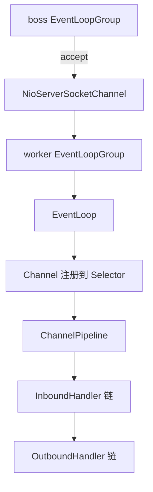

# Netty 的事件循环、Pipeline 与零拷贝

直接用 NIO 写服务，`Selector` 空轮询、半包粘包、写缓冲积压、连接断了没人关，每一样都要自己处理。Netty 把这些收进 `EventLoop`、`Pipeline`、`ByteBuf` 三个抽象里，代价是要理解它的线程模型——否则在 `channelRead` 里做一次数据库查询，整个 EventLoop 上的几百个连接一起卡住。

下面按一次连接的走向讲：先看组件职责，再拆 `NioEventLoop` 的循环、Reactor 的对应关系、Pipeline 的事件传播，然后是 ByteBuf 与零拷贝的四种形态，最后是几个常见配置错误。

## 组件与职责

| 组件 | 职责 | 注意 |
|---|---|---|
| `Channel` | 一条连接的读写抽象 | 实现如 `NioSocketChannel` |
| `EventLoop` | 一个线程，跑 I/O 与任务队列 | 一个 EventLoop 可带多个 Channel |
| `EventLoopGroup` | 管理 EventLoop 的池 | 通常 boss/worker 分开 |
| `ChannelPipeline` | 有序的 Handler 链 | 入站与出站方向相反 |
| `ByteBuf` | 字节容器 | 有读写双索引，可池化 |

`ChannelFuture` 承载异步结果，`ChannelPromise` 是可写的版本，用于在流程里回填成功或失败。

## 一、连接建立后的数据走向



1. boss 组的 EventLoop 处理 `OP_ACCEPT`，拿到新连接。
2. 新 `Channel` 从 worker 组分配一个 EventLoop，并注册到该 EventLoop 的 `Selector`。
3. 入站数据从 Pipeline 头部进入，依次经过 `ChannelInboundHandler`。
4. `ctx.write()` 产生出站事件，从当前 Handler 往回走向 Pipeline 尾部，经 `ChannelOutboundHandler` 编码后写出。

第 4 步的方向容易记错：入站是 head → tail，出站是 tail → head，且从**当前节点**开始而不是从头。所以在中间某个 Handler 里 `ctx.write()`，它会经过前面的出站 Handler。

## 二、Reactor 与 EventLoop

### 经典 Reactor 结构

Netty 的模型是 Reactor 的变体：一个 Acceptor 接连接，多个 Handler 处理 I/O。

```java
public class Reactor implements Runnable {
    final Selector selector;
    final ServerSocketChannel serverSocket;

    Reactor(int port) throws IOException {
        selector = Selector.open();
        serverSocket = ServerSocketChannel.open();
        serverSocket.socket().bind(new InetSocketAddress(port));
        serverSocket.configureBlocking(false);
        SelectionKey sk = serverSocket.register(selector, SelectionKey.OP_ACCEPT);
        sk.attach(new Acceptor());
    }

    public void run() {
        try {
            while (!Thread.interrupted()) {
                selector.select();
                Iterator<SelectionKey> it = selector.selectedKeys().iterator();
                while (it.hasNext()) {
                    dispatch(it.next());
                    it.remove();          // 必须移除，否则下次仍是就绪状态
                }
            }
        } catch (IOException ex) { /* ... */ }
    }

    void dispatch(SelectionKey k) {
        Runnable r = (Runnable) k.attachment();
        if (r != null) {
            r.run();
        }
    }

    class Acceptor implements Runnable {
        public void run() {
            try {
                SocketChannel c = serverSocket.accept();
                if (c != null) {
                    new Handler(selector, c);
                }
            } catch (IOException ex) { /* ... */ }
        }
    }
}
```

对应到 Netty：

| 经典 Reactor | Netty |
|---|---|
| `Reactor` | `NioEventLoop` |
| `Acceptor` | `NioMessageUnsafe.read` 里的 accept 分支 |
| `Handler` | `ChannelPipeline` 中的一组 Handler |

`ChannelInitializer` 不承担 accept，它只在 Channel 注册完成后往 Pipeline 里装 Handler。把两者混为一谈，会在排查「连接进来了但没有 Handler 被调用」时找错方向。

### NioEventLoop 的主循环

`run()` 一轮只做三件事：

```java
protected void run() {
    for (;;) {
        try {
            select();               // 等就绪事件，同时兼顾定时任务
            processSelectedKeys();  // 处理 I/O
            runAllTasks();          // 跑队列里的任务
        } catch (Throwable t) {
            handleLoopException(t);
        }
    }
}
```

`select()` 里有两处值得注意：

- 传入的 timeout 是到最近一个定时任务的剩余时间（`delayNanos`），这样 `schedule` 的任务不会被 `select` 的阻塞拖住。
- 连续空返回超过阈值（`MIN_PREMATURE_SELECTOR_RETURNS`，默认 512）会调用 `rebuildSelector()`，换一个新的 `Selector`。这是为绕开 Linux 上 epoll 空轮询的 JDK 缺陷，现象是 CPU 单核跑满而流量正常。

`runAllTasks()` 会先搬一次到期定时任务，然后按 deadline 限量执行，每 64 个任务检查一次超时：

```java
if ((runTasks & 0x3F) == 0) {
    lastExecutionTime = ScheduledFutureTask.nanoTime();
    if (lastExecutionTime >= deadline) {
        break;
    }
}
```

限量是为了不让任务队列饿死 I/O。但一个**单个**任务跑得久，限量就无效了——这是在 `channelRead` 里同步调 RPC 会把整组连接卡死的原因。

### processSelectedKeys 的分支

```java
int readyOps = k.readyOps();
if ((readyOps & SelectionKey.OP_CONNECT) != 0) {
    int ops = k.interestOps();
    k.interestOps(ops & ~SelectionKey.OP_CONNECT);  // 连上后取消关注，否则一直触发
    unsafe.finishConnect();
}
if ((readyOps & SelectionKey.OP_WRITE) != 0) {
    ch.unsafe().forceFlush();
}
if ((readyOps & (SelectionKey.OP_READ | SelectionKey.OP_ACCEPT)) != 0 || readyOps == 0) {
    unsafe.read();   // readyOps == 0 也要读一次，处理连接被对端关闭的情况
}
```

`OP_WRITE` 只有写缓冲积压时才会被注册，平时不关注——`Selector` 上注册了 `OP_WRITE` 但 socket 一直可写，会导致空转满 CPU。

### 线程模型的约束

- 同一 `Channel` 的所有事件由同一个线程处理，Handler 里不需要加锁。
- 跨线程写要用 `channel.writeAndFlush()`，Netty 会把它封装成任务投递到目标 EventLoop。
- EventLoop 线程数默认是 `CPU 核数 × 2`，I/O 密集型可上调，纯转发场景降到核数也能跑。
- 阻塞操作要丢到业务线程池：`DefaultEventLoopGroup` 只适合跑非阻塞的 CPU 任务，它并不提供线程隔离之外的保护。

## 三、Pipeline 与 Handler

```java
public class EchoServerHandler extends ChannelInboundHandlerAdapter {
    @Override
    public void channelRead(ChannelHandlerContext ctx, Object msg) {
        ctx.write(msg);          // 不 flush，等一批读完统一刷
    }

    @Override
    public void channelReadComplete(ChannelHandlerContext ctx) {
        ctx.flush();
    }

    @Override
    public void exceptionCaught(ChannelHandlerContext ctx, Throwable cause) {
        ctx.close();
    }
}
```

几个约定：

- `ctx.write()` 从当前 Handler 往出站方向传，`channel.write()` 从 Pipeline 尾部开始。
- `msg` 若是 `ByteBuf`，用完必须释放；`SimpleChannelInboundHandler` 会自动释放，`ChannelInboundHandlerAdapter` 不会。漏释放的表现是堆外内存持续增长直到 `OutOfDirectMemoryError`。
- 传播异常要么调 `ctx.fireExceptionCaught(cause)`，要么自己处理，吞掉异常会让连接半死不活。
- 编解码器放在 Pipeline 前部，`LengthFieldBasedFrameDecoder` 这类拆包器必须在业务 Handler 之前。

## 四、ByteBuf

`ByteBuf` 是抽象类，不直接 `new`，用 `Unpooled` 或分配器创建：

```java
ByteBuf buf = ctx.alloc().buffer(256);      // 跟随 Channel 的分配器（默认池化）
buf.writeInt(1);
buf.writeBytes(payload);

int id = buf.readInt();                     // readerIndex 前移
int readable = buf.readableBytes();          // writerIndex - readerIndex
buf.release();                               // 引用计数归零才真正归还内存
```

与 `ByteBuffer` 的差别：

- 读写双索引，切换读写不需要 `flip()`。
- 容量按需扩展，`ensureWritable()` 自动扩容。
- 引用计数管理，池化分配靠它归还；忘记 `release()` 就是泄漏。
- 支持 `slice()` / `duplicate()` 共享底层内存，不复制数据。

池化在 4.1 起是默认行为（`PooledByteBufAllocator`），显式设置只在需要换分配策略时才有意义：

```java
// 服务端：option 作用于父 Channel（监听 socket），childOption 作用于每条连接
b.childOption(ChannelOption.ALLOCATOR, PooledByteBufAllocator.DEFAULT);
b.childOption(ChannelOption.TCP_NODELAY, true);
```

写成 `option(ChannelOption.ALLOCATOR, ...)` 只影响监听 socket，对业务连接无效——这是配置「看起来生效了其实没有」的典型。

## 五、零拷贝的四种形态

「零拷贝」在 Netty 里指四件不同的事，混着说会误判性能瓶颈：

| 形态 | 做法 | 省掉什么 |
|---|---|---|
| 堆外缓冲 | 直接读进 `DirectByteBuf` | 堆内到堆外的一次复制 |
| 组合缓冲 | `CompositeByteBuf` 拼多个 `ByteBuf` | 合并时的整段复制 |
| 切片与视图 | `slice()` / `duplicate()` | 拆分时的数据复制 |
| 文件传输 | `FileRegion` + `transferTo` | 用户态与内核态之间的拷贝 |

前三种只在 JVM 内部省复制，最后一种才涉及系统调用层面的零拷贝。`FileRegion` 依赖 `sendfile`，在启用 TLS 时不可用（需要加密就必须读进用户态），这时只能退回 `ChunkedFile`。

```java
// 组合缓冲：把 header 和 body 合成一个逻辑上的连续缓冲
CompositeByteBuf composite = Unpooled.compositeBuffer();
composite.addComponents(true, header, body);   // true 表示自动调整 writerIndex
```

## 六、常见配置与排查

- **写缓冲水位**：`WriteBufferWaterMark` 的默认高低水位是 32KB / 64KB，`channel.isWritable()` 变 false 时该降速。慢消费者场景要调大，否则 `writeAndFlush` 会不断堆积直到 OOM。
- **连接空闲检测**：`IdleStateHandler` 读空闲要配合业务层心跳，只加 Handler 不发心跳没有意义。
- **`SO_BACKLOG`**：默认值偏小，高并发建连时可以上调到 1024。
- **`TCP_NODELAY`**：Netty 默认开启，小包场景没必要关。
- **关闭顺序**：`shutdownGracefully()` 会先停止接收新任务再退出，不要用 `shutdownNow()`。

| 现象 | 常见原因 |
|---|---|
| CPU 单核 100%，流量正常 | epoll 空轮询，看是否触发 `rebuildSelector` |
| 堆外内存增长到 OOM | `ByteBuf` 未 `release()` |
| 业务处理变慢拖垮所有连接 | EventLoop 里做了阻塞调用 |
| 客户端收不到数据也不报错 | 写缓冲满了但没检查 `isWritable()` |

## 相关阅读

- [JNA：Java 调用原生库的实践](/backend/jna)：需要落到底层库时怎么接
- [Kafka 存储与复制机制](/backend/kafka)：消息系统的网络层实现
- [Spring 容器、AOP 与声明式事务的实现](/backend/spring)：容器内的线程与生命周期

