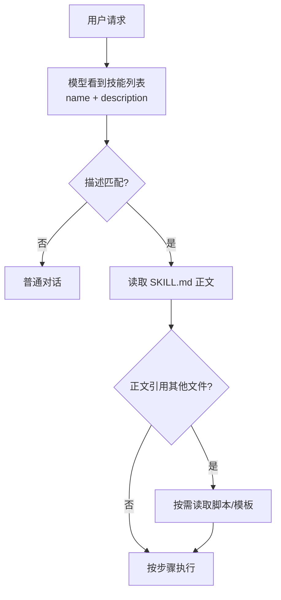

# Getting Started with AI Agent Skills: From Concept to a Runnable Skill Package

The same model, when asked "how do I commit code?" in a web chat, will only give you three git commands; in Claude Code, say "help me commit," and it will first run `git status`, read the diff, dig through the project's commit history to learn the style, then write a good message and ask you to confirm. The difference isn't in the model weights, but in that `SKILL.md` in the working directory.

Below we cover the division of labor between Skills, tools, and MCP, the structure and loading mechanism of SKILL.md, two directly runnable examples, and lessons from debugging and pitfalls.

## Key Takeaways

- **Skills are instruction manuals for the model**, written in Markdown; no code changes or training required—put them in a directory and they take effect
- **Loading is tiered**: normally only the name and description take up a few dozen tokens; the body is read only when a task matches, and bundled scripts are read only when needed
- **One Skill per directory**; `SKILL.md` must have `name` and `description`, and other files are referenced as needed
- **If it's poorly written, it's usually the description that's broken**: `description` determines whether it gets triggered, and the body determines whether it does the right thing after being triggered

## 1. Concepts: Division of Labor Across Three Layers

What the model can do on its own is reason and generate text. To make it "able to do" something, three things need to work together:

| Layer | Responsibility |
|---|---|
| Tool invocation | Provides atomic actions, such as reading files and running commands |
| MCP | Connects external systems through a unified protocol |
| Skills | Teach the model how to combine actions to accomplish a task |

Tools are the hands, MCP is the interface, and Skills are the operating manual. Without a manual, when facing the `bash` tool, the model can only improvise, and the same task takes a different path each time; with a manual, the process is fixed and results are reproducible.

Specifically for the "commit code" task:

```
没有 Skill：
  模型 → 建议三条命令 → 用户手动执行

有 Skill：
  git status → git diff → 读 git log 学风格
  → 生成 message → 用户确认 → git add + git commit
```

The difference is that the knowledge is written in a file rather than pieced together ad hoc with prompts each time.

## 2. Why Files Instead of Stuffing It into the System Prompt

The system prompt is sent every turn. Instructions for a complex process can easily run to thousands of tokens, making the always-on cost high, and ten processes stacked together will interfere with one another.

Skills solve this with "read on demand":

| Stage | Loaded Content | Approximate Cost |
|---|---|---|
| Startup | Names + descriptions of all skills | A few dozen tokens each |
| Task match | The body of that skill's `SKILL.md` | Several thousand tokens |
| When needed during execution | Bundled scripts, templates, reference docs | Read per file |

This way, even with twenty skills installed, the context won't be blown up; only the one actually used is expanded. The cost is an extra file-read round trip, and the model must be able to judge from the description whether it "should be used."

## 3. Loading Flow



A clear description of "when to use it" determines the judgment at step C; a clear body of "how to do it" determines the quality at H. Neither requires special syntax—just natural language plus necessary command examples.

## 4. Writing Your First Skill

Directory structure:

```
~/.claude/skills/
└── commit-helper/
    ├── SKILL.md          # 必需
    ├── scripts/          # 可选：脚本
    └── references/       # 可选：长文档
```

`SKILL.md` consists of frontmatter and body:

```markdown
---
name: commit-helper
description: 按项目规范生成 commit message 并提交。当用户要求提交代码、
  整理改动、写提交信息时使用。
---

# 提交代码

## 流程

1. `git status` 确认改动范围，有未跟踪文件先问是否加入
2. `git diff` 读具体改动，按文件归纳意图
3. `git log --oneline -10` 看历史风格，跟随现有前缀习惯
4. 生成 message 给用户确认，确认后才执行 `git add` 和 `git commit`

## 约束

- 不执行 `git push`，除非用户明确要求
- 不提交 `.env`、密钥文件、大体积二进制
- 一次提交只做一件事，改动混杂时先拆分

## 示例

输入：修改了登录校验和两个测试文件
输出：`fix(auth): 修正 token 过期判断`
```

Key points:

- `name` uses lowercase and hyphens, matching the directory name
- `description` states the trigger conditions, includes phrases users might actually say, and is kept within a few hundred characters
- Write steps in the body using imperative sentences, and include one input/output example—more effective than adjectives
- When tool restrictions are needed, declare them with `allowed-tools`, for example allowing only `Bash(git:*)` and `Read`

Project-level skills go under the repository's `.claude/skills/`, are committed along with the code, and are shared by the team; personal skills go in `~/.claude/skills/` and are available across projects.

## 5. Hands-on: Weather Query Skill

A skill with scripts better illustrates the value of "read on demand":

```
weather-helper/
├── SKILL.md
└── scripts/
    └── weather.py
```

```python
# scripts/weather.py
import json, os, sys, urllib.parse, urllib.request

city = sys.argv[1]
key = os.environ["OPENWEATHER_API_KEY"]
q = urllib.parse.quote(city)
url = (f"https://api.openweathermap.org/data/2.5/weather"
       f"?q={q}&appid={key}&units=metric&lang=zh_cn")
with urllib.request.urlopen(url, timeout=10) as r:
    d = json.load(r)
print(json.dumps({
    "city": d["name"],
    "temp": d["main"]["temp"],
    "feels": d["main"]["feels_like"],
    "desc": d["weather"][0]["description"],
    "humidity": d["main"]["humidity"],
}, ensure_ascii=False))
```

```markdown
---
name: weather-helper
description: 查询指定城市的实时天气与体感温度。用户问天气、气温、
  要不要带伞、穿什么衣服时使用。
allowed-tools: Bash(python3:*), Read
---

# 天气查询

## 步骤

1. 从用户消息中取城市名；没有则问，不要猜
2. 运行 `python3 scripts/weather.py "<城市>"`
3. 脚本返回 JSON：temp 温度、feels 体感、desc 描述、humidity 湿度
4. 用一句话给结论，再补穿衣或带伞建议

## 异常处理

- 退出码非 0：读 stderr，区分「城市不存在」与「Key 无效」
- 超时：重试一次，仍失败则告知用户接口不可用，不要编造天气
```

The `description` includes "bring an umbrella" and "what should I wear" because users really do ask that way; writing only "query weather" would miss these phrasings.

## 6. Debugging

```bash
# 1. 结构检查：目录里必须有 SKILL.md
ls -R ~/.claude/skills/weather-helper

# 2. 脚本单独跑通，再交给模型
OPENWEATHER_API_KEY=xxx python3 scripts/weather.py 杭州
```

Troubleshooting order:

1. **Not triggered** → Add the user's exact wording to `description`, and restart the session so the skill list is rescanned
2. **Triggered but steps go off track** → The body steps are not specific enough; add commands and decision conditions
3. **Error** → First run the script manually to determine whether the problem is in the script or in how it is invoked
4. **Verbose output** → Specify the output format and length in the body

After changing a skill file, you must restart the session for it to reload—this is the easiest thing to forget.

## 7. Design Principles

| Principle | Description |
|---|---|
| Single responsibility | One skill does only one thing; split mixed processes |
| Specific descriptions | Write the exact words users would say, not abstract goals |
| Executable steps | Each step corresponds to one command or one clear decision |
| Examples first | One input/output example beats three paragraphs of explanation |

## 8. Common Pitfalls

- **Stuffing the entire project documentation into SKILL.md**: An overly long body takes up context; put long documents in `references/` and keep only the index and key conclusions in the body
- **Writing the description as a feature introduction**: `description` is used by the model for routing decisions; trigger words matter more than adjectives
- **Scripts without error handling**: Network failures and missing keys must produce clear messages; otherwise the model will make up results
- **Granting overly broad permissions**: Give `allowed-tools` only what this process requires; if `Read` suffices, don't grant `Bash`
- **Skills with the same name spread across multiple directories**: When project-level and personal-level skills share a name, behavior is undefined; confirm loading priority before renaming
- **Forgetting version control**: `~/.claude/skills/` should also go into git so you don't have to rewrite it when switching machines

## 9. Acquiring and Sharing

For ready-made skills, start with the official repository and community collections; installation usually means copying the directory to `~/.claude/skills/`:

```bash
git clone https://github.com/user/awesome-skills.git
cp -r awesome-skills/<skill-name> ~/.claude/skills/
```

Publish your own skills with the following structure so others can use them by copying the directory:

```markdown
# SKILL.md frontmatter 至少包含
name: my-skill
description: 做什么 + 什么时候用
```

Add three sections to the README: dependencies, configuration items (environment variables), and a minimal example. Add a license as needed; MIT is the most common.

## Related Reading

- [Hermes Agent: A Self-Hostable Open-Source AI Agent](/en/ai/hermesAgent): The host environment for running these skills
- [OpenClaw Open-Source AI Assistant Deployment Guide](/en/ai/openclaw): A complete example of integrating with a messaging platform

## References

- [Claude Code Documentation](https://docs.anthropic.com)
- [Anthropic: Introducing Agent Skills](https://www.anthropic.com/news/agent-skills)
- [Model Context Protocol](https://modelcontextprotocol.io)
- [MCP Official Server List](https://github.com/modelcontextprotocol/servers)