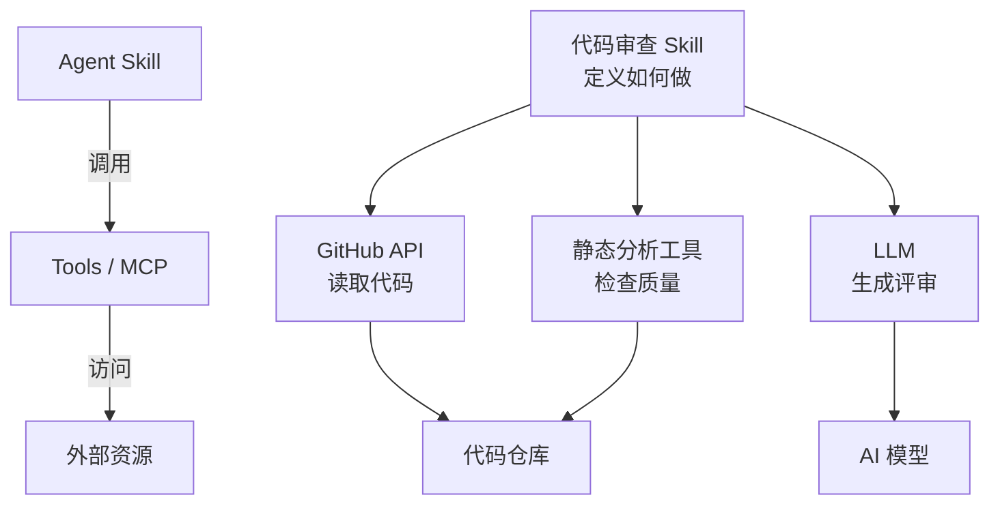
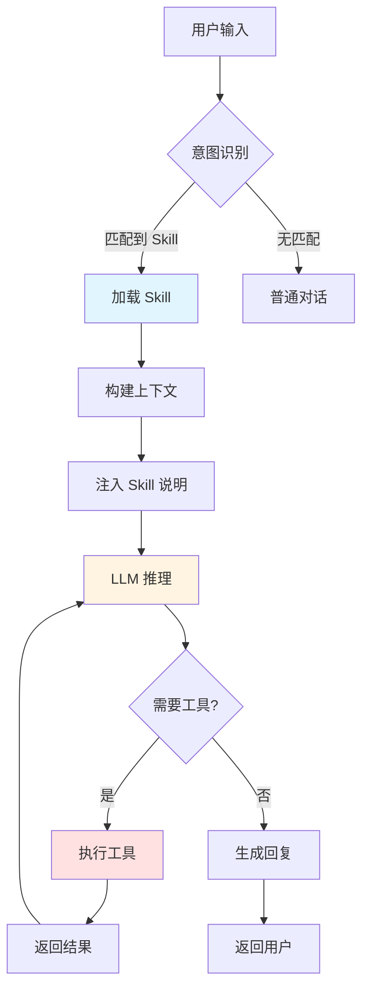

# AI Agent Skills: A Complete Beginner's Guide - Taking AI from "Knowing" to "Doing"

When you ask ChatGPT to help you write code, it can offer suggestions; but when you ask Claude Code to commit code, it can not only analyze the changes and generate a commit message, but also directly execute the `git commit` command. The difference behind this lies in **Agent Skills**.

This article systematically explains the core concepts and working principles of Skills, and uses real-world examples to help you get started quickly, transforming your AI Agent from "armchair theorizing" into a "hands-on expert."

## 1. What Are Agent Skills

### 1.1 A Real-World Scenario

Let's start with a real-world scenario to understand Skills:

**Scenario: Committing Code with Git**

```
【没有 Skills 的 AI】
用户："帮我提交代码"
AI："你可以这样做：
     1. 运行 git add .
     2. 运行 git commit -m '你的提交信息'
     3. 建议使用清晰的提交信息..."

→ 只能提供建议，需要用户手动执行

【有 Skills 的 AI】
用户："帮我提交代码"
AI："好的，让我帮你：
     [执行] git status
     [执行] git diff
     [分析] 发现修改了 3 个文件，主要是优化了用户认证逻辑
     [生成] feat(auth): 优化用户认证流程

     这个提交信息可以吗？(y/n)"
用户："y"
AI："[执行] git add src/auth.js src/middleware.js tests/auth.test.js
     [执行] git commit -m 'feat(auth): 优化用户认证流程'
     ✓ 提交成功！"

→ 完整的工作流，从分析到执行
```

**The essential difference**:
- The former: LLM's knowledge capability (knows how to do it)
- The latter: the execution capability granted by Skills (can actually do it)

### 1.2 The Essence of Skills

**Agent Skills** provide AI Agents with **reusable packages of professional knowledge**, enabling AI not only to "know" what to do but also to "be able to" actually execute it.

Use an analogy to understand this:

| Role | Analogy | Description |
|------|---------|-------------|
| **LLM** | A knowledgeable university student | Has extensive knowledge and can answer various questions, but lacks practical experience |
| **Skills** | Professional skills training | Teaches "how to write standardized commits" and "how to review code quality" |
| **Agent with Skills** | Senior engineer | Has both theoretical knowledge and rich practical experience and tools |

**Three core problems that Skills solve**:

1. **Knowledge cutoff problem**
   - ❌ LLM: Training data has a cutoff date and does not know the latest technologies
   - ✅ Skills: Obtain information in real time through tools (API calls, file reading)

2. **Lack of execution capability**
   - ❌ LLM: Can only generate text and cannot execute commands
   - ✅ Skills: Bind tool functions to actually perform operations

3. **Unclear process**
   - ❌ LLM: May miss steps for complex tasks
   - ✅ Skills: Predefine a complete workflow to ensure no steps are missed

### 1.3 Skills vs Tools vs MCP: Terminology Distinction

In the AI Agent ecosystem, these terms are often used interchangeably, but they have clear distinctions:

| Concept | Definition | Example | Characteristics |
|---------|------------|---------|-----------------|
| **Tools** | A single function | `get_weather(city)` | Atomic operation, does only one thing |
| **MCP** | Protocol connecting AI with external systems | GitHub MCP Server | Provides a standard interface for a set of tools |
| **Skills** | Workflow + domain knowledge | "Code Review Skill" | Defines a complete execution process and best practices |

**Hierarchy diagram**:



**One-sentence summary**:
- **Skills**: Teach AI "how to do it" (workflows, best practices)
- **Tools/MCP**: Give AI "capabilities" (calling APIs, accessing data)
- **Combining both**: This is what forms a complete Agent system

### 1.4 Why Skills Are Needed

**Question 1: Why not just use a Prompt?**

```markdown
# 方式 A：每次都写详细 Prompt
用户："帮我提交代码，要遵循 conventional commits 规范，
     先看 git status，再看 git diff，然后..."

# 方式 B：使用 Skill
用户："/commit"

→ Skills 就是"可重用的 Prompt + 工具绑定"
```

**Question 2: Why not just use Function Calling?**

Function Calling only solves "calling tools," but does not solve:
- ✗ When to call which tool (requires explicit instructions)
- ✗ The calling order of tools (requires explanation every time)
- ✗ Domain knowledge and best practices (require repeated emphasis)

Skills = Function Calling + workflow definition + domain knowledge

## 2. How Skills Work

### 2.1 Core Mechanisms

Skills enhance AI Agent capabilities through the following three mechanisms:

#### Mechanism 1: Context Injection

**Principle**: Inject the Skill's instructions into the LLM's System Prompt

```
原始 Prompt：
"你是一个有帮助的 AI 助手。"

加载 Skill 后：
"你是一个有帮助的 AI 助手。

# Git Commit Skill
当用户要提交代码时，按以下步骤操作：
1. 执行 git status 查看改动
2. 执行 git diff 分析具体变更
3. 查看最近 3 次 commit 了解项目风格
4. 生成符合 Conventional Commits 的 message
5. 询问用户确认后执行提交

注意：
- 使用现在时态："Add feature" 而非 "Added feature"
- 第一行不超过 50 字符
- 遵循项目现有风格"
```

**Effect**: The LLM is like reading an operation manual, knowing what to do under what circumstances.

#### Mechanism 2: Tool Calling

**Principle**: LLM outputs a specific format → system parses → executes function → returns result

```typescript
// LLM 的输出（简化示例）
{
  "tool": "bash",
  "command": "git status"
}

// 系统执行
const result = await executeBash("git status");

// 结果返回给 LLM
"On branch main
 Changes not staged for commit:
   modified: src/auth.js"

// LLM 继续推理
"我看到修改了 auth.js，让我看看具体改动..."
```

**Key points**:
- The LLM does not directly execute commands; it only "requests" execution
- The system is responsible for actual execution and returning results
- Multi-turn dialogue until the task is complete

#### Mechanism 3: Workflow Orchestration

**Principle**: Predefine the execution steps and logic of a task

```yaml
workflow:
  - step: check_changes
    tool: bash
    command: "git status"

  - step: analyze_diff
    tool: bash
    command: "git diff"

  - step: check_style
    tool: bash
    command: "git log -5 --oneline"

  - step: generate_message
    tool: llm
    instruction: "基于以上信息生成 commit message"

  - step: confirm
    tool: ask_user

  - step: commit
    tool: bash
    command: "git commit -m '{message}'"
    condition: user_confirmed
```

### 2.2 Full Lifecycle

The complete process of a Skill from trigger to completion:



**Detailed step breakdown**:

1. **Intent Recognition** (Trigger Matching)

   ```
   输入："/commit" 或 "帮我提交代码"
   匹配：检查是否有对应的 Skill
   结果：加载 commit Skill
   ```

2. **Context Building** (Context Building)

   ```
   基础 Prompt + Skill 说明 + 相关文件（references/）
   ```

3. **LLM Reasoning** (Reasoning)

   ```
   理解任务 → 规划步骤 → 决定下一步动作
   ```

4. **Tool Execution** (Tool Execution)

   ```
   LLM 输出：{"tool": "bash", "command": "git status"}
   系统执行：result = exec("git status")
   返回给 LLM：result
   ```

5. **Multi-round Iteration** (Iteration)

   ```
   LLM → 工具 → 结果 → LLM → 工具 → ...
   直到任务完成
   ```

### 2.3 Real-world Case: Anatomy of the Commit Skill

Let's take a deep dive into how a real Skill works.

#### Skill Definition (SKILL.md)

```markdown
---
name: commit
description: 智能分析代码变更并生成规范的 Git commit message
---

# Git Commit Skill

## 触发方式
- Slash 命令：`/commit`
- 自然语言：用户说"提交代码"、"创建 commit"等

## 工作流程

### 第一步：检查当前状态
执行 `git status` 了解：
- 哪些文件被修改
- 哪些在暂存区
- 是否有未跟踪文件

### 第二步：分析具体改动
执行 `git diff` 查看：
- 增加了哪些代码
- 删除了哪些代码
- 修改的核心逻辑

### 第三步：学习项目风格
执行 `git log -5 --oneline` 观察：
- 项目使用什么 commit 规范（如 Conventional Commits）
- 常用的 type（feat/fix/docs 等）
- 描述的详细程度

### 第四步：生成 commit message
基于以上信息，生成符合以下规范的 message：
- 格式：`<type>(<scope>): <subject>`
- type：feat/fix/docs/style/refactor/test/chore
- subject：简洁描述（<50 字符），使用现在时
- body（可选）：详细说明为什么改、怎么改

### 第五步：用户确认
显示生成的 message，询问用户是否满意。

### 第六步：执行提交
用户确认后：
1. 执行 `git add <files>`（如果需要）
2. 执行 `git commit -m "<message>"`
3. 显示提交成功信息

## 工具权限
- Bash：执行 git 命令
- Read：读取项目文件以更好理解上下文

## 注意事项
- **不要**自动 push，除非用户明确要求
- **不要**提交 .env、密钥等敏感文件
- **总是**在执行前让用户确认
```

#### Execution Flow Demo

```
【第1轮对话】
用户："/commit"

LLM（内心）：触发了 commit skill，按照流程第一步
LLM（输出）：
  tool: bash
  command: "git status"

系统执行 → 返回结果：
  "On branch main
   Changes not staged:
     modified: src/auth.js
     modified: tests/auth.test.js"

【第2轮对话】
LLM（内心）：看到改动，执行第二步
LLM（输出）：
  tool: bash
  command: "git diff src/auth.js"

系统执行 → 返回结果：
  "+ function validateToken(token) { ... }
   - function checkToken(token) { ... }"

【第3轮对话】
LLM（内心）：理解改动，执行第三步
LLM（输出）：
  tool: bash
  command: "git log -5 --oneline"

系统执行 → 返回结果：
  "feat(auth): add JWT support
   fix(user): resolve login issue
   docs: update API documentation"

【第4轮对话】
LLM（内心）：项目使用 Conventional Commits，生成 message
LLM（输出文本）：
  "我分析了代码改动，建议使用以下 commit message：

   feat(auth): 重构 token 验证逻辑

   - 将 checkToken 重命名为 validateToken，语义更清晰
   - 添加了对过期 token 的检查
   - 更新了相关测试用例

   这个 message 可以吗？(y/n)"

【第5轮对话】
用户："y"

LLM（输出）：
  tool: bash
  command: "git add src/auth.js tests/auth.test.js &&
           git commit -m 'feat(auth): 重构 token 验证逻辑...'"

系统执行 → 返回结果：
  "[main 7a9f3c2] feat(auth): 重构 token 验证逻辑
   2 files changed, 15 insertions(+), 8 deletions(-)"

LLM（输出文本）：
  "✓ 提交成功！
   Commit ID: 7a9f3c2"
```

#### Why It Is Designed This Way

**Design highlights analysis**:

1. **Multi-step verification**
   - ✅ Does not directly generate the message; collects information first
   - ✅ Learns the project style instead of using a fixed template
   - ✅ User confirmation step to avoid incorrect commits

2. **Context awareness**
   - ✅ Reads `git log` to learn project conventions
   - ✅ Analyzes `git diff` to understand the essence of changes
   - ✅ Generated message conforms to project style

3. **Security considerations**
   - ✅ Does not automatically push
   - ✅ Must confirm before committing
   - ✅ Can specify files to commit

**What would happen without a Skill?**

```
用户："帮我提交代码"
LLM："好的，运行 git commit -m 'update code'"

→ 没有分析改动
→ 没有学习项目风格
→ commit message 质量低
→ 可能提交敏感文件
```
## 3. Hands-On: Create Your First Skill

### 3.1 Environment Setup

**Option A: Use Claude Code CLI** (Recommended)

```bash
# 安装 Claude Code CLI（npm 方式已弃用，官方推荐原生安装器）
curl -fsSL https://claude.ai/install.sh | bash

# 初始化项目
claude init

# 创建 Skill 目录
mkdir -p .claude/skills/weather-assistant
```

**Option B: Use Cursor / other editors that support Skills**

Make sure the editor supports Agent Skills.

**Directory Structure**:

```
project/
├── .claude/
│   └── skills/
│       └── weather-assistant/
│           ├── SKILL.md          # 核心文件
│           ├── references/       # 可选：参考文档
│           └── assets/           # 可选：资源文件
```

### 3.2 Example: Create a Weather Assistant Skill

#### Step 1: Define Requirements

We want to create a Skill that enables AI to:
- Get the weather for a specified city
- Provide weather advice (whether suitable to go out, clothing suggestions)
- Support multi-city comparison

#### Step 2: Write SKILL.md

Create file: `.claude/skills/weather-assistant/SKILL.md`

```markdown
---
name: weather-assistant
description: 获取实时天气并提供生活建议
---

# 天气助手 Skill

## 触发条件
当用户询问天气相关问题时自动触发，例如：
- "北京今天天气怎么样"
- "上海明天会下雨吗"
- "/weather 深圳"

## 工作流程

### 第一步：识别城市
从用户输入中提取城市名称。如果未指定，询问用户。

### 第二步：调用天气 API
使用 `get_weather` 工具获取实时天气数据：
- 温度（当前/最高/最低）
- 天气状况（晴/雨/雪/雾等）
- 湿度、风速
- 空气质量指数（AQI）

### 第三步：分析并生成建议
基于天气数据，提供实用建议：
- **温度建议**：
  - < 10°C：提醒穿厚外套
  - 10-20°C：建议穿长袖
  - > 30°C：提醒防晒、多喝水

- **天气状况建议**：
  - 下雨：携带雨具
  - 雾霾（AQI > 150）：戴口罩，减少户外活动
  - 晴天：适合外出

### 第四步：格式化输出
使用清晰的格式展示信息：
```

📍 City: Beijing
🌡️ Temperature: 15°C (10°C ~ 18°C)
🌤️ Weather: Cloudy
💨 Wind speed: Level 3
💧 Humidity: 60%
🏭 Air quality: Good (AQI 55)

💡 Suggestions:
- Suitable for outdoor activities
- Recommend wearing a long-sleeved shirt or light jacket
- Moderate UV, pay attention to sun protection

```

## 工具使用

### get_weather(city: string)
获取指定城市的实时天气数据。

**参数**：
- `city`：城市名称（支持中英文）

**返回**：
```json

{
  "city": "Beijing",
  "temp": 15,
  "temp_min": 10,
  "temp_max": 18,
  "weather": "Cloudy",
  "humidity": 60,
  "wind_speed": 3,
  "aqi": 55
}

```

## 注意事项
- 温度单位默认使用摄氏度（°C）
- 如果 API 调用失败，礼貌告知用户并建议稍后重试
- 不要捏造天气数据
```

#### Step 3: Implement Tool Functions

Create file: `.claude/skills/weather-assistant/tools.ts`

```typescript
// 天气 API 工具函数
export async function get_weather(city: string) {
  try {
    // 这里使用真实的天气 API（示例使用 OpenWeatherMap）
    const API_KEY = process.env.WEATHER_API_KEY;
    const url = `https://api.openweathermap.org/data/2.5/weather?q=${city}&appid=${API_KEY}&units=metric&lang=zh_cn`;

    const response = await fetch(url);
    const data = await response.json();

    if (data.cod !== 200) {
      return {
        error: true,
        message: `无法获取 ${city} 的天气信息`
      };
    }

    return {
      city: data.name,
      temp: Math.round(data.main.temp),
      temp_min: Math.round(data.main.temp_min),
      temp_max: Math.round(data.main.temp_max),
      weather: data.weather[0].description,
      humidity: data.main.humidity,
      wind_speed: Math.round(data.wind.speed * 3.6), // m/s to km/h
      aqi: await getAQI(city) // 另一个 API 获取空气质量
    };
  } catch (error) {
    console.error('Weather API error:', error);
    return {
      error: true,
      message: 'API 调用失败，请稍后重试'
    };
  }
}

async function getAQI(city: string): Promise<number> {
  // 调用空气质量 API
  // 这里简化处理，实际应该调用真实 API
  return 55;
}

// 导出工具定义（给 LLM 使用）
export const weatherTools = [
  {
    name: 'get_weather',
    description: '获取指定城市的实时天气信息',
    input_schema: {
      type: 'object',
      properties: {
        city: {
          type: 'string',
          description: '城市名称（中文或英文）'
        }
      },
      required: ['city']
    }
  }
];
```

#### Step 4: Register Skill

Create file: `.claude/skills/weather-assistant/index.ts`

```typescript
import { weatherTools, get_weather } from './tools';
import { readFileSync } from 'fs';
import { join } from 'path';

export class WeatherSkill {
  name = 'weather-assistant';
  description = '获取实时天气并提供生活建议';

  // 加载 SKILL.md 内容
  systemPrompt: string;

  constructor() {
    const skillPath = join(__dirname, 'SKILL.md');
    this.systemPrompt = readFileSync(skillPath, 'utf-8');
  }

  // 工具定义
  get tools() {
    return weatherTools;
  }

  // 工具处理器
  async handleToolCall(toolName: string, params: any) {
    switch (toolName) {
      case 'get_weather':
        return await get_weather(params.city);
      default:
        throw new Error(`Unknown tool: ${toolName}`);
    }
  }

  // 匹配触发条件
  match(userInput: string): boolean {
    const keywords = ['天气', '温度', '下雨', '晴天', '气温', 'weather'];
    return keywords.some(kw => userInput.toLowerCase().includes(kw)) ||
           userInput.startsWith('/weather');
  }
}
```

#### Step 5: Test Skill

Create test file: `test-weather-skill.ts`

```typescript
import Anthropic from '@anthropic-ai/sdk';
import { WeatherSkill } from './.claude/skills/weather-assistant';

const client = new Anthropic({
  apiKey: process.env.ANTHROPIC_API_KEY
});

async function testWeatherSkill() {
  const skill = new WeatherSkill();

  const userInput = "北京今天天气怎么样？";

  // 检查是否匹配
  if (!skill.match(userInput)) {
    console.log('未匹配到天气 Skill');
    return;
  }

  console.log('✓ 匹配到天气 Skill');

  // 构建消息
  const messages: Anthropic.MessageParam[] = [
    { role: 'user', content: userInput }
  ];

  // 多轮对话
  while (true) {
    const response = await client.messages.create({
      model: 'claude-sonnet-5',
      max_tokens: 4096,
      system: skill.systemPrompt,
      tools: skill.tools,
      messages
    });

    console.log('\n--- LLM Response ---');
    console.log(JSON.stringify(response.content, null, 2));

    // 检查是否有工具调用
    const toolUse = response.content.find(c => c.type === 'tool_use');

    if (!toolUse || toolUse.type !== 'tool_use') {
      // 没有工具调用，任务完成
      const textContent = response.content.find(c => c.type === 'text');
      console.log('\n--- Final Answer ---');
      console.log(textContent?.text);
      break;
    }

    // 执行工具
    console.log(`\n--- Executing Tool: ${toolUse.name} ---`);
    const result = await skill.handleToolCall(toolUse.name, toolUse.input);
    console.log('Tool result:', result);

    // 将结果返回给 LLM
    messages.push({
      role: 'assistant',
      content: response.content
    });
    messages.push({
      role: 'user',
      content: [{
        type: 'tool_result',
        tool_use_id: toolUse.id,
        content: JSON.stringify(result)
      }]
    });
  }
}

// 运行测试
testWeatherSkill().catch(console.error);
```

Run the test:

```bash
# 设置环境变量
export ANTHROPIC_API_KEY="your-api-key"
export WEATHER_API_KEY="your-weather-api-key"

# 运行测试
ts-node test-weather-skill.ts
```

**Expected output**:

```
✓ 匹配到天气 Skill

--- LLM Response ---
[
  {
    "type": "tool_use",
    "name": "get_weather",
    "input": { "city": "北京" }
  }
]

--- Executing Tool: get_weather ---
Tool result: {
  city: '北京',
  temp: 15,
  temp_min: 10,
  temp_max: 18,
  weather: '多云',
  humidity: 60,
  wind_speed: 12,
  aqi: 55
}

--- LLM Response ---
[
  {
    "type": "text",
    "text": "📍 城市：北京\n🌡️ 温度：15°C（10°C ~ 18°C）\n..."
  }
]

--- Final Answer ---
📍 城市：北京
🌡️ 温度：15°C（10°C ~ 18°C）
🌤️ 天气：多云
💨 风速：12 km/h
💧 湿度：60%
🏭 空气质量：良（AQI 55）

💡 建议：
- 适合外出活动
- 建议穿长袖衬衫或薄外套
- 紫外线适中，注意防晒
```

### 3.3 Debugging Tips

**Tip 1: View the complete conversation log**

```typescript
// 在每次 API 调用前后打印日志
console.log('=== Request ===');
console.log(JSON.stringify(messages, null, 2));

const response = await client.messages.create({...});

console.log('=== Response ===');
console.log(JSON.stringify(response, null, 2));
```

**Tip 2: Validate tool functions step by step**

```typescript
// 先单独测试工具函数
const result = await get_weather('北京');
console.log(result);
// 确认返回格式正确后，再集成到 Skill
```

**Tip 3: Use Claude's thinking process**

Enable extended thinking (if supported):

```typescript
const response = await client.messages.create({
  model: 'claude-sonnet-5',
  max_tokens: 4096,
  thinking: {
    type: 'enabled',
    budget_tokens: 2000
  },
  // ...
});

// 查看 LLM 的思考过程
const thinking = response.content.find(c => c.type === 'thinking');
console.log('LLM 思考:', thinking?.thinking);
```
## 4. Best Practices and Common Issues

### 4.1 Design Principles

#### Principle 1: Single Responsibility

**❌ Bad design**:

```markdown
# 超级助手 Skill
- 发送邮件
- 查询天气
- 创建日历事件
- 翻译文本
- 生成图片
```

**✅ Good design**:

```markdown
# Email Sender Skill - 只负责发邮件
# Weather Skill - 只负责天气
# Calendar Skill - 只负责日历
```

**Reasons**:
- Easy to maintain and debug
- More precise trigger conditions
- Can be updated independently

#### Principle 2: Clear Trigger Conditions

**❌ Trigger conditions too broad**:

```markdown
## 触发条件
当用户需要帮助时触发。
```

→ Any issue could trigger it, resulting in false triggers

**✅ Explicit trigger conditions**:

```markdown
## 触发条件
满足以下任一条件时触发：
- 用户输入 `/weather`
- 用户消息包含关键词："天气"、"温度"、"下雨"、"气温"
- 用户询问某个城市的天气情况

**不触发**的情况：
- 询问历史天气（超出能力）
- 询问天气预测原理（科普问题，非工具使用）
```

#### Principle 3: User Confirmation for Critical Operations

**Dangerous operations must be confirmed**:

```typescript
// ❌ 直接执行
await deleteFile(filePath);

// ✅ 先确认
const confirmed = await askUser(
  `确认删除 ${filePath}？此操作不可恢复。(y/n)`
);
if (confirmed === 'y') {
  await deleteFile(filePath);
  return '文件已删除';
} else {
  return '操作已取消';
}
```

**Which operations require confirmation?**
- Delete files/data
- Git push
- Send emails/messages
- Modify configuration files
- Call paid APIs

### 4.2 Common Pitfalls

#### Pitfall 1: Forgetting to Handle Errors

**Problematic code**:

```typescript
export async function send_email(to: string, subject: string) {
  const result = await emailAPI.send({ to, subject });
  return '邮件已发送';
}
```

**Problem**: If the API call fails, the user receives incorrect feedback.

**Correct approach**:

```typescript
export async function send_email(to: string, subject: string) {
  try {
    const result = await emailAPI.send({ to, subject });

    if (!result.success) {
      return {
        success: false,
        error: `发送失败：${result.error}`
      };
    }

    return {
      success: true,
      message: `邮件已发送到 ${to}`
    };
  } catch (error) {
    console.error('Email API error:', error);
    return {
      success: false,
      error: 'API 调用失败，请检查网络连接'
    };
  }
}
```

#### Pitfall 2: Improper Permission Settings

**Risky example**:

```markdown
## 工具权限
- 完全的文件系统访问
- 执行任意 bash 命令
```

→ If malicious instructions are injected into the LLM, it may cause serious consequences

**Secure approach**:

```markdown
## 工具权限
- 文件系统：只读访问 `src/` 和 `docs/` 目录
- Bash：只允许 `git` 和 `npm` 命令
- 网络：只能访问白名单 API（api.github.com、api.weather.com）
```

#### Pitfall 3: Missing Execution Logs

**Problem**: When an error occurs, the cause cannot be traced.

**Solution**:

```typescript
class SkillExecutor {
  async execute(skill: Skill, input: string) {
    const executionId = crypto.randomUUID();

    console.log(`[${executionId}] 开始执行 ${skill.name}`);
    console.log(`[${executionId}] 用户输入: ${input}`);

    try {
      // ... 执行逻辑

      console.log(`[${executionId}] 执行成功`);
    } catch (error) {
      console.error(`[${executionId}] 执行失败:`, error);
      throw error;
    }
  }
}
```

### 4.3 Performance Optimization

#### Optimization 1: Reduce Context Length

**Problem**: SKILL.md is too long and consumes a large number of tokens.

**Solution**: Use the references directory

```
weather-assistant/
├── SKILL.md              # 核心流程（简短）
└── references/
    ├── api-docs.md       # API 详细文档（按需加载）
    └── examples.md       # 示例（按需加载）
```

In SKILL.md:

```markdown
## API 使用
详见 `references/api-docs.md`

## 示例
详见 `references/examples.md`
```

The LLM will automatically read the references files when needed.

#### Optimization 2: Cache Tool Results

```typescript
const cache = new Map();

export async function get_weather(city: string) {
  const cacheKey = `weather:${city}`;

  // 检查缓存（5分钟有效）
  const cached = cache.get(cacheKey);
  if (cached && Date.now() - cached.time < 5 * 60 * 1000) {
    return cached.data;
  }

  // 调用 API
  const data = await fetchWeather(city);

  // 存入缓存
  cache.set(cacheKey, { data, time: Date.now() });

  return data;
}
```
## 5. Getting and Sharing Skills

### 5.1 Where to Find Ready-made Skills

#### Option 1: GitHub Search

**Search Keywords**:
- `claude skills`
- `agent skills`
- `anthropic skills`
- `mcp server`

**Popular Repositories**:
- `anthropics/claude-code` - Official examples
- `modelcontextprotocol/servers` - Collection of MCP Servers
- Various Skills contributed by the community

**Example**:

```bash
# 克隆仓库
git clone https://github.com/user/awesome-skills.git

# 复制到你的项目
cp -r awesome-skills/commit-skill .claude/skills/
```

#### Option 2: MCP Ecosystem

**Official Resources**:
- **MCP Servers List**: https://modelcontextprotocol.io/servers
- **GitHub Organization**: https://github.com/modelcontextprotocol

**Popular MCP Servers**:

| Server | Function | Installation |
|--------|------|------|
| `@modelcontextprotocol/server-filesystem` | File system operations | `npm install @modelcontextprotocol/server-filesystem` |
| `@modelcontextprotocol/server-github` | GitHub integration | `npm install @modelcontextprotocol/server-github` |
| `@modelcontextprotocol/server-postgres` | Database queries | `npm install @modelcontextprotocol/server-postgres` |

**Using an MCP Server**:

```typescript
// 在 Skill 中使用 MCP Server 提供的工具
import { createMCPClient } from '@modelcontextprotocol/sdk';

const client = await createMCPClient({
  server: '@modelcontextprotocol/server-github',
  config: {
    token: process.env.GITHUB_TOKEN
  }
});

// 获取可用工具
const tools = await client.listTools();
```

#### Option 3: Community Platforms

**Claude Skills Community** (unofficial):
- Search for Claude communities on Discord/Reddit
- Look for Skill-sharing posts

### 5.2 How to Share Your Skill

#### Step 1: Standardize the Format

Make sure your Skill follows the standard format:

```
your-skill/
├── SKILL.md              # 必需
├── README.md             # 必需：使用说明
├── tools.ts              # 可选：工具实现
├── references/           # 可选
├── assets/               # 可选
└── examples/             # 推荐：使用示例
    └── example.md
```

#### Step 2: Write a Clear README

```markdown
# Weather Assistant Skill

获取实时天气并提供生活建议。

## 功能
- ✅ 实时天气查询
- ✅ 温度、湿度、风速
- ✅ 空气质量指数
- ✅ 生活建议

## 安装

\```bash
# 复制到项目
cp -r weather-assistant .claude/skills/

# 安装依赖（如有）
npm install
\```

## 配置

需要设置环境变量：

\```bash
export WEATHER_API_KEY="your-key"
\```

获取 API Key：https://openweathermap.org/api

## 使用

\```
用户："北京今天天气怎么样？"
AI："📍 城市：北京..."
\```

## 许可证
MIT
```

#### Step 3: Publish to GitHub

```bash
# 初始化仓库
git init
git add .
git commit -m "feat: initial commit"

# 推送到 GitHub
git remote add origin https://github.com/yourusername/weather-skill.git
git push -u origin main
```

#### Step 4: Add Topic Tags

Add these in your GitHub repository settings:
- `claude-skills`
- `agent-skills`
- `anthropic`
- `ai-agent`

This makes it easier for others to find your Skill.

## 6. Summary and Next Steps### 6.1 Recap of This Article

We systematically learned about AI Agent Skills:

**Core Concepts**:
- ✅ Skills are reusable packages of specialized knowledge
- ✅ They take AI from "knowing" to "doing"
- ✅ Skills ≠ Tools ≠ MCP (hierarchical relationship)

**How It Works**:
- ✅ Context injection: teaching AI how to do it
- ✅ Tool calling: enabling AI to actually execute
- ✅ Workflow orchestration: ensuring complete steps

**Hands-on Skills**:
- ✅ Analyzed the complete flow of the Commit Skill
- ✅ Created a Weather Skill from scratch
- ✅ Mastered design principles and best practices

### 6.2 Recommended Learning Path

**🔰 Beginner Path** (1-2 weeks)

1. **Understand the Basics**
   - Read the first two chapters of this article
   - Install Claude Code CLI
   - Try using existing Skills

2. **Get Hands-On**
   - Create the Weather Skill following Chapter 3
   - Modify parameters and test with different cities
   - Add new features (such as a 7-day forecast)

3. **Study Examples**
   - Examine 2-3 open-source Skills
   - Understand their design approach
   - Try improving or customizing them

**🚀 Intermediate Path** (2-4 weeks)

1. **Explore the MCP Ecosystem**
   - Learn the MCP protocol: https://modelcontextprotocol.io
   - Install and use 3-5 MCP Servers
   - Understand how Skills + MCP work together

2. **Create Complex Skills**
   - Multi-step workflows (such as a complete code review process)
   - Integrate multiple MCP Servers
   - Add error handling and logging

3. **Contribute to Open Source**
   - Open-source your Skill on GitHub
   - Write detailed documentation
   - Gather community feedback and iterate

**🎯 Advanced Path** (1-3 months)

1. **Build a Skills System**
   - Design a Skill loader
   - Implement a semantic matching engine
   - Add permission management

2. **Skills Marketplace**
   - Design a Skill discovery mechanism
   - Implement install/update functionality
   - Add a review and rating system

3. **Cross-Platform Compatibility**
   - Make your Skills run on multiple platforms
   - Follow open standards
   - Contribute to community specifications

### 6.3 Reference Resources

**Official Documentation**:
- [Model Context Protocol](https://modelcontextprotocol.io)
- [Anthropic Claude API](https://docs.anthropic.com)
- [Claude Code CLI](https://github.com/anthropics/claude-code)

**Technical Articles**:
- [Understanding Agent Skills](https://www.anthropic.com/news/agent-skills)
- [MCP in Practice](https://modelcontextprotocol.io/docs/guides)

**Community Resources**:
- [MCP GitHub Organization](https://github.com/modelcontextprotocol)
- [Claude Discord Community](https://discord.gg/anthropic)

**Learning Projects**:
- [Awesome Claude Skills](https://github.com/topics/claude-skills)
- [MCP Server Examples](https://github.com/modelcontextprotocol/servers)

---

**Next Steps**:

Choose a starting point that suits you:

1. 🎯 **Hands-on First**: Jump directly to Chapter 3 and create your first Skill
2. 📚 **Deep Dive into Theory**: Study the MCP protocol and Tool Calling mechanisms
3. 🔍 **Case Study Learning**: Find 3 open-source Skills and analyze their design

Whichever path you choose, the most important thing is **hands-on practice**. The learning curve for Skills isn't steep—the key is to take the first step!

Enjoy exploring the world of AI Agents! 🚀