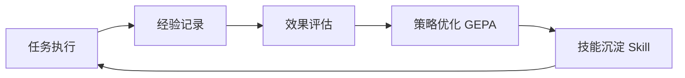
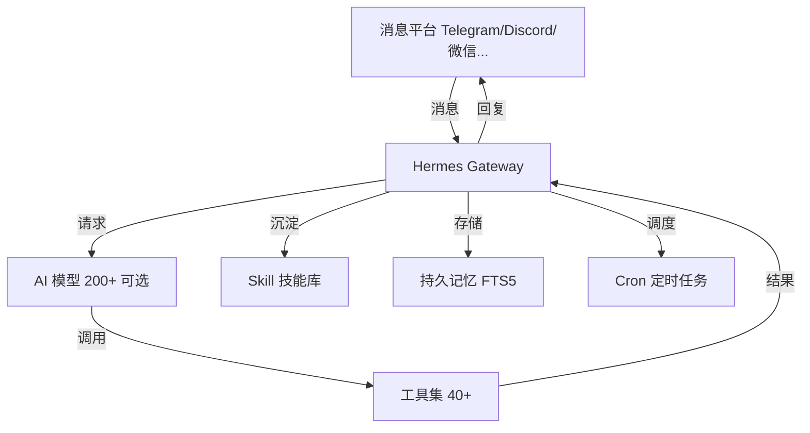

# Hermes Agent Open-Source AI Agent Deployment Guide

Most AI assistants on the market are like disposable products: when the conversation ends, their memory is wiped; ask as a different person, and they start over. **Hermes Agent aims to change this**—it is one of the few open-source agents that truly has a built-in "learning loop": after completing a task, it automatically distills the process into a skill, reuses it directly the next time it encounters a similar task, and gets faster and more attuned to you the more you use it.

It comes from [Nous Research](https://nousresearch.com)—creator of the open-source Hermes, Nomos, and Psyche model series—and its official positioning is "The agent that grows with you" (an agent that grows alongside you). In the 2026 open-source agent wave, it has leveraged the differentiator of "self-evolution" to accumulate 223k+ stars on GitHub.

## 1. What Is Hermes Agent?

### 1.1 Core Definition

Hermes Agent is an open-source, self-hosted autonomous AI agent framework (MIT license) that can be deployed locally, on a VPS, in Docker, or on serverless infrastructure. Its core feature is not "smarter conversation" but **the ability to continuously evolve**:

- Creates skills from experience
- Continuously improves skills through use
- Proactively prompts itself to persist knowledge
- Searches its own past conversations
- Builds a deep understanding of you across sessions

In one sentence: **traditional AI is a disposable tool, while Hermes Agent is a colleague that becomes more valuable the more you use it.**

### 1.2 What It Is Not

| Misconception | Truth |
|:-----|:-----|
| It is a chatbot wrapper | It is an autonomous agent that becomes more capable the longer it runs |
| An IDE-bound coding copilot | It can run on VPS, GPU clusters, and serverless |
| Locked to a single API | Supports 200+ models, with one-command switching via `hermes model` |
| Depends on your local computer | It can work on a cloud VM while you chat with it from Telegram |

### 1.3 The Team Behind It

Nous Research is the creator of the open-source Hermes, Nomos, and Psyche model series. In February 2026, it officially released Hermes Agent and completed a $50 million Series A funding round led by Paradigm (at a $1 billion valuation). Their judgment is straightforward: **the chatbot interaction paradigm has hit its ceiling, and the next direction is the "always-on digital employee."**

## 2. Core Features

### 2.1 Closed-Loop Learning System (Core Selling Point)



Hermes Agent is the **only agent with a built-in learning loop**:
- Automatically creates reusable Skill files after completing complex tasks
- Skills self-improve during use
- Continuously optimizes strategies through the **GEPA self-evolution system**—traditional reinforcement learning requires tens of thousands of evaluations to converge, while GEPA can complete strategy iteration in only 100-500 evaluations
- Compatible with the [agentskills.io](https://agentskills.io) open standard, so skills are portable, shareable, and open to community contributions

### 2.2 Persistent Memory

Traditional AI assistants are stateless; when the conversation ends, everything resets to zero. Hermes Agent breaks this premise:

- **Cross-session persistent memory**: automatically records conversations and extracts key information for storage
- **FTS5 full-text search + LLM summarization**: can search its own past conversations and recall across sessions
- **Honcho dialectical user modeling**: gradually builds a profile of your preferences, work habits, and needs
- **Proactive prompting**: it "reminds" itself to persist important knowledge rather than passively waiting

### 2.3 Multi-Platform Messaging Gateway

A single gateway process connects simultaneously to:

| Platform | Status |
|:-----|:-----|
| Telegram | ✅ Recommended, easy to configure |
| Discord | ✅ |
| Slack | ✅ |
| WhatsApp | ✅ |
| Signal | ✅ |
| Feishu / DingTalk / WeCom | ✅ Available for users in China |
| QQ / Email | ✅ |

All channels share a **unified memory and persona** and are online around the clock. It also supports voice message transcription and cross-platform conversation continuity.

### 2.4 Model-Agnostic, Zero Lock-In

Supports any model provider—Nous Portal, OpenRouter (200+ models), OpenAI, Anthropic Claude, DeepSeek, Hugging Face, NVIDIA NIM, Xiaomi MiMo, z.ai/GLM, Kimi/Moonshot, MiniMax, or custom endpoints.

```bash
hermes model   # 一条命令切换模型，无需改代码
```

For local scenarios, it is compatible with Ollama, vLLM, and SGLang.

### 2.5 Runs Anywhere

| Terminal Backend | Description |
|:-----|:-----|
| Local | Runs directly on a laptop/desktop |
| Docker | Container isolation |
| SSH | Remote server |
| Singularity | High-performance computing |
| Modal / Daytona | **Serverless persistence**: sleeps when idle, wakes on demand, and costs almost nothing when idle |
| Vercel Sandbox | Cloud development environment |

It can run on a $5 VPS or a GPU cluster, and serverless infrastructure costs approach zero when idle.

## 3. How It Works

### 3.1 Core Architecture



### 3.2 Learning Loop Details

1. **Experience recording**: records the complete process when executing complex tasks
2. **Effectiveness evaluation**: evaluates the quality of results
3. **Strategy optimization**: the GEPA system completes strategy iteration within 100-500 evaluations
4. **Skill distillation**: solidifies successful experience into reusable Skill files
5. **Reuse and improvement**: directly invokes the skill the next time a similar task arises and continues to improve it through use

### 3.3 Scheduled Automation

Built-in cron scheduler with natural language configuration, delivering to any platform:

```bash
# 每天 8:00 发送日报
hermes cron add "每天早上8点给我发送当日日程摘要" --deliver telegram

# 每周五备份
hermes cron add "每周五下午5点执行服务器备份" --deliver slack
```

Daily reports, nightly backups, and weekly inspections—all run automatically unattended.

### 3.4 Delegation and Parallelism

It can spawn isolated subagents to process multiple workflows in parallel; `execute_code` enables programmatic tool calls, compressing multi-step pipelines into a single inference call with zero context cost.

## 4. Differences from Traditional AI Assistants

| Feature | Traditional AI (ChatGPT/Claude Web) | Hermes Agent |
|:-----|:-----|:-----|
| **Interaction method** | Open a specific app/website | Integrated into everyday messaging apps |
| **Memory capability** | Single-session or limited context | Unlimited cross-session memory + user modeling |
| **Learning capability** | None (fixed model) | **Closed learning loop, stronger with use** |
| **Proactivity** | Passively waits for instructions | Proactively pushes notifications and schedules tasks |
| **Running location** | Fixed in the cloud | Local/VPS/Serverless, your choice |
| **Model selection** | Single vendor | Freely switch among 200+ models |
| **Skill distillation** | None | Automatically creates reusable Skills |

## 5. How to Deploy Hermes Agent

### 5.1 Installation

**Linux / macOS / WSL2 / Android (Termux):**

```bash
curl -fsSL https://hermes-agent.nousresearch.com/install.sh | bash

# 安装完成后刷新 shell
source ~/.bashrc  # 或 source ~/.zshrc
```

**Windows (PowerShell):**

```powershell
iex (irm https://hermes-agent.nousresearch.com/install.ps1)
```

macOS / Windows users can also directly download the **Hermes Desktop** installer (graphical interface, including CLI and desktop app).

### 5.2 Quick Configuration

```bash
# 1. 初始化（交互式引导：选择模型提供商、配置 API Key）
hermes setup

# 2. 或直接选择模型
hermes model   # 交互式选择提供商和模型

# 3. 验证聊天
hermes
```

**Recommended path: Nous Portal** — a single subscription covers 300+ models, and also comes with Tool Gateway (web search, image generation, TTS, etc.).

**Rule**: If Hermes cannot complete a normal chat, don't stack more features on top first. Get one clean conversation working first, then gradually add gateway, cron, skills, voice, and routing.

### 5.3 Configuring Messaging Platforms (Gateway)

After CLI chat is verified, configure the messaging gateway:

```bash
hermes gateway setup
```

Follow the prompts to connect Telegram / Discord / Slack / WhatsApp / Signal / Feishu / DingTalk / WeCom, etc. After that, you can talk to it on your phone while it works on the server.

### 5.4 VPS Deployment Recommendations

**Beginner configuration:**

```yaml
platform: Telegram
model: DeepSeek / GLM / Kimi (国内可达)
hosting: 5美元 VPS
integrations:
  - None (start simple)
cost: ~$5/月 (VPS) + API 按量
```

**Advanced configuration:**

```yaml
platform: Telegram + Slack
model: OpenRouter (按需切换 200+ 模型)
hosting: VPS + Docker 隔离
integrations:
  - MCP Server
  - Cron 定时任务
  - 浏览器自动化
```

**Professional configuration:**

```yaml
platform: 全平台接入
model: 多模型路由 + 本地 Ollama
hosting: Modal/Daytona Serverless (闲置近零成本)
integrations:
  - 智能家居
  - 数据库巡检
  - 批量轨迹生成 (研究用途)
```

### 5.5 Docker Deployment

```dockerfile
FROM python:3.12-slim

# 安装 Hermes Agent
RUN curl -fsSL https://hermes-agent.nousresearch.com/install.sh | bash

# 数据持久化（记忆/技能/配置）
VOLUME ["/root/.hermes"]

WORKDIR /app
CMD ["hermes", "gateway", "start"]
```

```yaml
# docker-compose.yml
services:
  hermes:
    build: .
    volumes:
      - hermes-data:/root/.hermes
    restart: always
volumes:
  hermes-data:
```

## 6. Cost Analysis

Hermes Agent itself is **completely open source and free** (MIT); costs mainly come from model APIs and the hosting environment:

| Item | Option | Cost |
|:-----|:-----|:------|
| **Software License** | Open source and free | $0 |
| **Runtime Environment** | Local computer | $0 |
| | VPS (basic) | $5/month |
| | Serverless (Modal/Daytona) | Near-zero cost when idle |
| **AI Models** | Local models (Ollama, requires 16GB+ VRAM) | $0 |
| | API pay-as-you-go (DeepSeek/GLM, etc.) | $1-20/month |
| | High-end models (Opus/Claude) | $20-100+/month |

**Cost-saving strategies**:
- High-frequency simple tasks → cheap models (DeepSeek, GLM, Haiku)
- Complex reasoning tasks → high-end models (Opus, Sonnet 5)
- Privacy-sensitive tasks → local Ollama (zero API fees)
- Serverless deployment → sleeps when idle, wakes on demand

## 7. Practical Application Scenarios

**Scenario 1: Personal digital butler**
- Automatically sends a schedule summary to Telegram every day at 8:00
- Detects important emails and notifies immediately
- Periodically reminds of to-dos

**Scenario 2: Server inspector**
- Automatically checks VPS disk, memory, and service status weekly
- Proactively pushes alerts when anomalies occur
- Automatically performs backups and reports results

**Scenario 3: Research assistant**
- Collects materials and generates summaries in bulk
- Distills the research workflow into a Skill for one-click reuse next time
- Exports trajectories for training next-generation tool-calling models

**Scenario 4: Team collaboration bot**
- Connects to Slack/Feishu/DingTalk
- Unified memory of multiple members' preferences
- Periodically generates weekly reports and inspection reports

## 8. Security Mechanisms

Hermes Agent v0.5.0 has made dedicated security hardening, merging 200+ security patches:

- Command approval (dangerous operations require confirmation)
- Docker container sandbox isolation
- Path traversal protection
- SSRF mitigation
- Credential management
- Maintains a zero-CVE record

> "Powerful evolutionary capability, but the reins must stay in human hands."

## 9. Summary

The core value of Hermes Agent in one sentence: **It is the only AI agent with a built-in learning loop** — creates skills from experience, improves skills through use, remembers you across sessions, supports 200+ models, and runs on any infrastructure.

Suitable for:
- Those who want to experience an AI assistant that "gets smarter the more you use it"
- Developers who need a 24/7 online digital employee
- Teams that want to escape single-model lock-in
- Users who like to control their own data and self-host

**Quick Start**:

```bash
curl -fsSL https://hermes-agent.nousresearch.com/install.sh | bash
hermes setup
```

## Reference Resources

- [Hermes Agent Official Website](https://hermes-agent.nousresearch.com)
- [GitHub Repository](https://github.com/NousResearch/hermes-agent) (223k+ stars, MIT)
- [Official Documentation](https://hermes-agent.nousresearch.com/docs)
- [Nous Research](https://nousresearch.com)
- [agentskills.io Skill Standard](https://agentskills.io)
- [OpenRouter Model Routing](https://openrouter.ai)