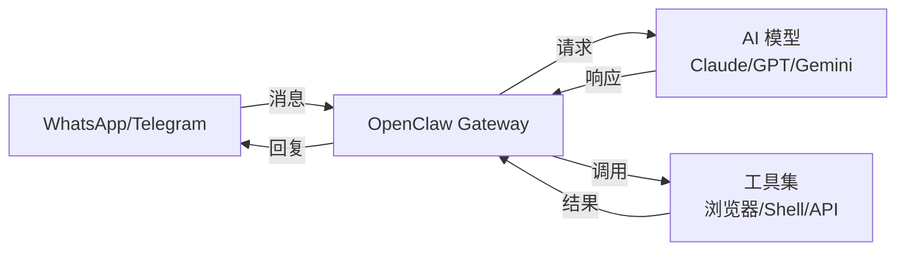
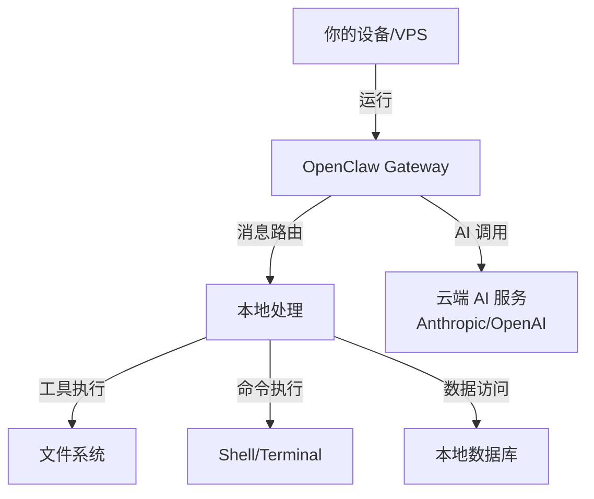
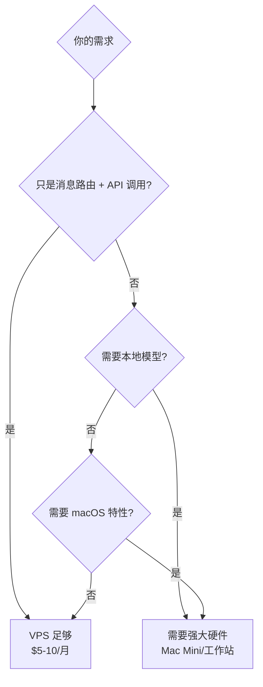
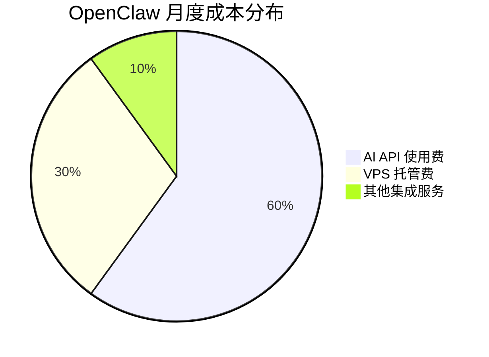
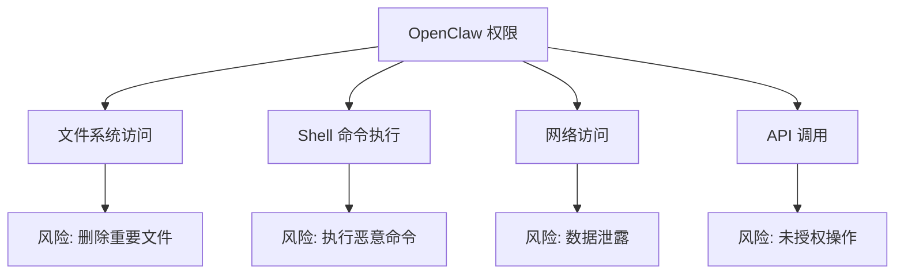
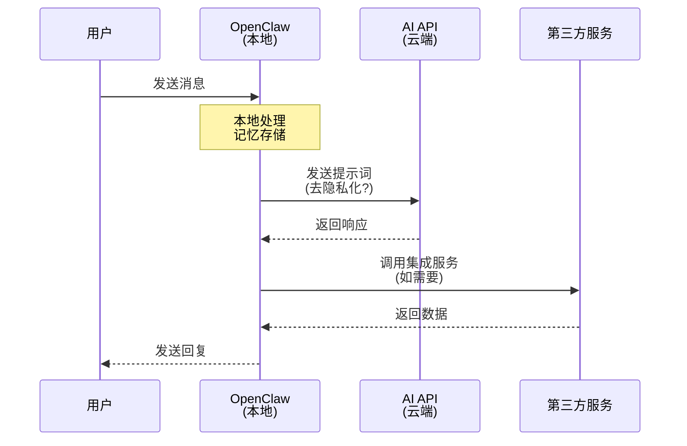

# OpenClaw Open-Source AI Assistant Deployment Guide

Imagine having an AI assistant that not only remembers what you said last week, but also proactively reminds you of important matters before you even ask, and can even help you complete all kinds of tasks on your computer—booking restaurants, managing email, controlling smart home devices, and generating reports. This is no longer science fiction; it is the reality that **OpenClaw** is bringing to life.

OpenClaw is an open-source, message-first AI personal assistant that has recently sparked heated discussion in Silicon Valley tech circles and even boosted Mac mini sales. Its biggest difference from traditional AI assistants is that you do not go visit it; instead, it integrates into your everyday communication tools and becomes a true "24/7 online employee."

## 1. What Is OpenClaw?

### 1.1 Core Definition

**OpenClaw** is a self-hosted, local-first AI assistant agent (AI Agent) that can run on your own device (Mac, Linux, or Windows/WSL2) as a powerful, always-on personal assistant.

Unlike AI tools such as ChatGPT and Claude that require opening a web page or app, OpenClaw's design philosophy is:

> Your AI assistant should be like a real colleague: **present in your messaging apps**, always ready, continuously remembering, and proactively serving.

### 1.2 Differences from Traditional AI Assistants

| Feature | Traditional AI (ChatGPT/Siri) | OpenClaw |
|:-----|:----------------------|:---------|
| **Interaction method** | Open a specific app/website | Via common messaging apps (WhatsApp/Telegram) |
| **Memory capability** | Single session or limited context | Unlimited long-term memory, persists across sessions |
| **Proactivity** | Passively waits for instructions | Can proactively push notifications and reminders |
| **Computer control** | Cannot operate the local system | Full control over the running device |
| **Data privacy** | Data stored in the cloud | Runs locally, data under your control |
| **Customizability** | Fixed functionality | Open source, freely extensible |

### 1.3 Three Core Features

**1. Persistent Memory**

OpenClaw has a sophisticated built-in memory system that automatically records all conversations, extracts key information, and saves it as Markdown-format "memory files." Over time, it will increasingly understand your preferences, work habits, and needs.

**2. Proactive Notifications**

This is the most exciting feature: OpenClaw can proactively push information without you asking. For example:
- Automatically send a summary of the day's schedule at 8 a.m. every day
- Notify you immediately when important emails are detected
- Regularly remind you of to-dos
- Monitor system status and issue warnings

**3. Task Automation**

Because OpenClaw runs on your computer, it can:
- Execute shell commands
- Operate the browser (fill out forms, scrape data)
- Manage the file system
- Call various APIs
- Control smart home devices

## 2. How OpenClaw Works

### 2.1 System Architecture

OpenClaw's architecture can be expressed as a simple formula:

```
消息应用 ⇄ OpenClaw Gateway ⇄ AI 模型 + 工具
```



**Workflow description:**

1. You send a message to OpenClaw in WhatsApp or Telegram
2. The Gateway receives the message and decides how to handle it
3. It sends the request to the configured AI model (such as Claude Opus)
4. The model may call tools (execute commands, query databases, control devices)
5. After collecting all results, it replies in the original message thread

### 2.2 Why Is It Called a "Gateway"?

A traditional chatbot is just a single conversational interface, whereas a **Gateway** is an orchestrator that can:

- **Unify multiple inboxes**: connect to multiple messaging platforms at once
- **Maintain state**: remember context and history
- **Run scheduled tasks**: automate via cron
- **Connect to real services**: calendar, email, notes, smart home, and more

This is why OpenClaw can implement "proactive behavior"—the Gateway can check conditions on a schedule and proactively message you when thresholds are met.

### 2.3 Advantages of Running Locally



**Privacy advantages**:
- Message routing logic executes on your machine
- Automation scripts and integration configuration are controlled by you
- AI model calls still require cloud access (unless using local models)
- The "assistant brain" and integrations are entirely under your control

## 3. Core Features and Use Cases

### 3.1 Full Computer Control

OpenClaw has no traditional "guardrail" restrictions; it can do almost anything you can do on a computer:

**Example: Automated File Management**

```bash
# 你的指令：整理桌面文件
# OpenClaw 执行：
mkdir -p ~/Desktop/Organized/{Images,Documents,Code}
mv ~/Desktop/*.png ~/Desktop/Organized/Images/
mv ~/Desktop/*.pdf ~/Desktop/Organized/Documents/
mv ~/Desktop/*.js ~/Desktop/Organized/Code/
```

**Example: Generate Reports**

```bash
# 你的指令：生成本周工作报告
# OpenClaw 会：
1. 检查 Git 提交记录
2. 查询任务管理工具（Todoist/Notion）
3. 汇总会议日程
4. 生成 Markdown 报告
5. 发送到指定邮箱
```

### 3.2 Unlimited Long-Term Memory

OpenClaw's memory system is based on the file system and uses **Markdown format for storage**:

```
/clawd/
  ├── memory/
  │   ├── 2026-01-20-daily.md
  │   ├── 2026-01-21-daily.md
  │   └── 2026-01-26-daily.md
  ├── preferences.md
  └── context.md
```

**Example daily memory note:**

```markdown
# 2026-01-26 Daily Memory

## Conversations
- User asked about OpenClaw installation
- Helped configure Telegram integration
- Created cron job for daily briefings

## Key Information
- User prefers morning briefings at 8 AM
- Important project deadline: 2026-02-15
- Frequently used: Notion, Todoist, Gmail

## Tasks Completed
- [x] Set up Spotify control
- [x] Configure Philips Hue integration
- [x] Create weekly report automation
```

These memory files can:
- Be opened and edited with Obsidian
- Be searched with Raycast
- Be processed automatically with Hazel
- Be fully portable and backed up at any time

### 3.3 Multi-Platform Messaging Integration

Messaging platforms supported by OpenClaw:

| Platform | Support status | Notes |
|:-----|:--------|:-----|
| WhatsApp | ✅ | Most popular mobile option |
| Telegram | ✅ | Recommended, easy to configure |
| Discord | ✅ | Good for team collaboration |
| Slack | ✅ | Preferred for enterprise environments |
| iMessage | ✅ | Requires BlueBubbles |
| Signal | ✅ | For privacy-focused users |
| Microsoft Teams | ✅ | Enterprise-grade support |
| WeChat | ✅ | Available to users in China |
| Matrix | ✅ | Decentralized protocol |

### 3.4 Real-World Use Cases

**Scenario 1: Daily Smart Briefing**

```yaml
时间: 每天 8:00 AM
触发: Cron 定时任务
操作:
  - 检查日历，获取今日会议
  - 扫描 Todoist，提取重要任务
  - 查询 Gmail，标记紧急邮件
  - 检查天气和交通状况
  - 生成个性化简报
  - 通过 Telegram 发送文本 + 语音版本
```

**Scenario 2: Smart Email Categorization**

```javascript
// OpenClaw 可以执行的自动化脚本
async function processEmails() {
  const emails = await fetchUnreadEmails();

  for (const email of emails) {
    if (isNewsletter(email)) {
      await unsubscribe(email);
    } else if (isPriority(email)) {
      await notifyUser(email);
      await draftReply(email);
    } else {
      await categorize(email);
    }
  }
}
```

**Scenario 3: Research Assistant**

Compared with the traditional approach:

| Traditional approach | OpenClaw approach |
|:--------|:-------------|
| 1. Open multiple browser tabs | 1. Send a research topic |
| 2. Search for information separately | 2. OpenClaw automatically searches and compares |
| 3. Copy and paste into notes | 3. Automatically generates summaries and conclusions |
| 4. Manually organize comparisons | 4. Saves to Notion/Obsidian |
| 5. Easy to lose context | 5. Automatically reminds you to follow up next week |

**Scenario 4: Smart Home Control**

```bash
# 语音消息："晚安"
# OpenClaw 执行：
curl -X PUT "http://philips-hue-bridge/api/lights/all/state" \
  -d '{"on":false}'

curl -X POST "http://sonos-speaker/api/pause"

# 发送确认消息："已关闭所有灯光和音乐，晚安😴"
```

### 3.5 Integration Ecosystem

OpenClaw supports a rich set of integrations:

**AI models (choose your own brain)**
- Anthropic Claude (recommended)
- OpenAI GPT-4
- Google Gemini
- xAI Grok
- Mistral, DeepSeek
- Local models (Ollama/llama.cpp)

**Productivity tools**
- Notion, Obsidian
- Todoist, Things 3
- Apple Notes, Bear
- Trello, GitHub

**Smart home**
- Philips Hue (smart lighting)
- Govee (LED light strips)
- Home Assistant (universal integration)

**Multimedia**
- Spotify (music control)
- Sonos (audio system)
- Shazam (music recognition)

**Other**
- Gmail (email management)
- Browser Control (browser automation)
- Webhooks (custom integrations)
- Voice (voice message-to-text / text-to-speech)

## 4. How to Deploy OpenClaw

### 4.1 Hardware Requirements: The Mac Mini Myth and the Truth

Recently, many Mac Mini "stack photos" have appeared on social media, and some people have even posted about buying 40 Mac Minis at once to run OpenClaw. This has led to a misconception: **Do you have to buy a Mac Mini?**

**The truth is: in most cases, you don't!**



**Actual requirements analysis:**

| Use Case | Recommended Hardware | Monthly Cost |
|:--------|:--------|:------|
| Basic use (messaging + API) | VPS (2GB RAM) | $5-10 |
| Moderate use (+ automation scripts) | VPS (4GB RAM) | $10-20 |
| Advanced use (+ browser automation) | VPS (8GB RAM) or local machine | $20-40 |
| Professional use (local LLM) | Mac Mini M4 or workstation | One-time $600+ |

**Why do some people choose a Mac Mini?**
1. Low electricity cost (about $2/month)
2. Silent and fanless
3. Compact size
4. Full macOS ecosystem (iMessage, Apple Notes, etc.)
5. Can run local LLMs (MLX-optimized)

**Recommended configurations:**
- Beginners: Start with a free-tier VPS or your local computer
- Advanced users: A basic VPS from DigitalOcean/Linode
- Professional users: Mac Mini M4 or a self-built server

### 4.2 Deployment Steps

#### Step 1: Choose a Runtime Environment

**Option A: Run locally (recommended for beginners)**

Pros:
- Full control
- No server knowledge required
- Easy to test

Cons:
- Only works when your computer is on
- Cannot achieve 24/7 uptime

**Option B: Run on a VPS (recommended for production use)**

Pros:
- Always online 24/7
- Enables proactive notifications
- Low cost

Cons:
- Requires basic Linux knowledge
- Requires configuring remote access

#### Step 2: One-Click Installation

Run the following command in your terminal:

```bash
# macOS / Linux
curl -fsSL https://openclaw.ai/install.sh | bash

# 或使用 wget
wget -O - https://openclaw.ai/install.sh | bash
```

**Installation process overview:**

```bash
🦀 OpenClaw Installer
━━━━━━━━━━━━━━━━━━━━━━━━━━━━━━━━━━━

✓ Checking system requirements
✓ Installing dependencies
✓ Downloading OpenClaw
✓ Setting up directory structure

📁 Installation directory: ~/.openclaw
🔧 Configuration wizard starting...
```

#### Step 3: Configuration Wizard

The installation script launches an interactive configuration wizard:

**3.1 Choose an AI model provider**

```bash
? Select your preferred AI model:
  ❯ Anthropic Claude (recommended)
    OpenAI ChatGPT
    Google Gemini
    Local model (Ollama)
    Multiple models
```

**3.2 Enter your API Key**

```bash
? Enter your Anthropic API key:
  ▸ sk-ant-api03-**********************

💡 Tip: Get your API key from https://console.anthropic.com
```

**3.3 Choose a messaging platform**

```bash
? Which messaging platforms do you want to use?
  ◉ Telegram (recommended for beginners)
  ◯ WhatsApp
  ◯ Discord
  ◯ Slack
  ◯ iMessage

? How many platforms? 1-3 platforms recommended
```

**3.4 Configure Telegram (example)**

```bash
📱 Telegram Setup
━━━━━━━━━━━━━━━━━━━━━━━━━━━━━━━━━━━

Step 1: Create a bot with @BotFather
  1. Open Telegram
  2. Search for @BotFather
  3. Send /newbot
  4. Follow the instructions

Step 2: Enter your bot token
? Telegram Bot Token:
  ▸ 1234567890:ABCdefGHIjklMNOpqrSTUvwxyz

Step 3: Get your Chat ID
  1. Send a message to your bot
  2. Visit: https://api.telegram.org/bot<TOKEN>/getUpdates
  3. Copy your chat_id

? Your Telegram Chat ID:
  ▸ 123456789

✓ Telegram configured successfully!
```

#### Step 4: First Test

```bash
🚀 Starting OpenClaw...

✓ Gateway started
✓ Connected to Anthropic API
✓ Telegram bot online
✓ Memory system initialized

━━━━━━━━━━━━━━━━━━━━━━━━━━━━━━━━━━━
🎉 OpenClaw is ready!

Send a message to your Telegram bot to test:
  Example: "Hello, what can you do?"

Configuration file: ~/.openclaw/openclaw.json
Logs: ~/.openclaw/logs/
Memory: ~/.openclaw/memory/
━━━━━━━━━━━━━━━━━━━━━━━━━━━━━━━━━━━
```

#### Step 5: Advanced Configuration (Optional)

**Enable auto-start (VPS):**

```bash
# 创建 systemd 服务
sudo tee /etc/systemd/system/openclaw-gateway.service > /dev/null <<EOF
[Unit]
Description=OpenClaw Gateway
After=network-online.target
Wants=network-online.target
StartLimitBurst=5
StartLimitIntervalSec=60

[Service]
ExecStart=/usr/local/bin/openclaw gateway --port 18789
Restart=always
RestartSec=5
RestartPreventExitStatus=78
TimeoutStopSec=30
TimeoutStartSec=30
SuccessExitStatus=0 143
OOMPolicy=continue
KillMode=control-group

[Install]
WantedBy=multi-user.target
EOF

# 启用并启动服务
sudo systemctl daemon-reload
sudo systemctl enable --now openclaw-gateway.service

# 查看状态
sudo systemctl status openclaw-gateway
```

**Set up scheduled tasks:**

```bash
# 编辑 crontab
crontab -e

# 添加每日简报（每天早上 8 点）
0 8 * * * ~/.openclaw/skills/daily-briefing.sh

# 添加每周总结（每周五下午 5 点）
0 17 * * 5 ~/.openclaw/skills/weekly-summary.sh
```

### 4.3 Recommended Configurations

**Beginner-friendly configuration:**

```yaml
platform: Telegram
model: Claude Opus 5
hosting: Local (laptop/desktop)
integrations:
  - None (start simple)
cost: ~$20/month (API usage only)
```

**Advanced user configuration:**

```yaml
platform: Telegram + WhatsApp
model: Claude Opus 5 + GPT-4o
hosting: DigitalOcean VPS ($10/month)
integrations:
  - Gmail
  - Google Calendar
  - Todoist
cost: ~$50/month (VPS + API)
```

**Professional user configuration:**

```yaml
platform: 全平台支持
model: Claude + Local LLM (Ollama)
hosting: Mac Mini M4
integrations:
  - 全生产力工具
  - 智能家居
  - 浏览器自动化
cost: $600 一次性 + $20/month (电费 + API)
```

## 5. Cost Analysis

### 5.1 Cost Breakdown

OpenClaw itself is **open source and free**. Costs mainly come from:



### 5.2 Detailed Cost Table

| Item | Option | Monthly Cost |
|:-----|:-----|:------|
| **Software license** | Open source and free | $0 |
| **Runtime environment** | Local computer | $0 |
| | VPS (basic) | $5-10 |
| | VPS (standard) | $10-20 |
| | Mac Mini (electricity) | ~$2 |
| **AI model** | Claude API (light) | $10-20 |
| | Claude API (moderate) | $30-50 |
| | Claude API (heavy) | $50-100+ |
| | Local model | $0 |
| **Integration services** | Basic free services | $0 |
| | Premium service subscriptions | $10-30 |
| **Total** | Minimum configuration | $10-30/month |
| | Standard configuration | $40-70/month |
| | Professional configuration | $100+/month |

### 5.3 Cost-Effectiveness Optimization Tips

**1. API usage optimization**

```yaml
策略一：混合模型
  - 简单任务使用 Claude Haiku 4.5 (便宜)
  - 复杂任务使用 Claude Opus 5 (贵但准确)

策略二：本地模型
  - 使用 Ollama 运行开源模型
  - 适合: 隐私敏感任务、高频低复杂度任务

策略三：缓存优化
  - 启用 prompt caching
  - 减少重复调用
```

**2. Hosting optimization**

```yaml
阶段一：本地测试 (0-1个月)
  - 费用: $0
  - 目标: 熟悉功能，确定需求

阶段二：VPS 部署 (1-3个月)
  - 费用: $5-10/月
  - 目标: 验证 24/7 使用价值

阶段三：决策升级 (3个月后)
  - 继续 VPS: 性价比高
  - 购买硬件: 长期使用更划算
```

## 6. Security and Precautions

### 6.1 Security Risk Analysis

OpenClaw's power comes from its "unrestricted permissions," but this also brings significant security risks:



**Security issues on GitHub:**
As of now, the OpenClaw project has **500+ security-related Issues**, mainly concerning:
- Insufficient permission management
- Lack of sandbox isolation
- Command injection risks
- Sensitive data exposure

### 6.2 Recommended Security Practices

**🔒 Basic security rules**

```yaml
规则一：独立环境运行
  ❌ 不要: 在主工作电脑上直接安装
  ✅ 应该: 使用独立 VPS 或虚拟机

规则二：最小权限原则
  ❌ 不要: 以 root 用户运行
  ✅ 应该: 创建专用用户，限制权限

规则三：隔离敏感数据
  ❌ 不要: 连接包含公司机密的邮箱
  ✅ 应该: 使用独立账号或测试数据

规则四：审查自动化脚本
  ❌ 不要: 盲目允许 OpenClaw 执行任何命令
  ✅ 应该: 先在测试环境验证
```

**🛡️ Advanced security configuration**

**1. Use Docker container isolation**

```dockerfile
# Dockerfile 示例
FROM node:24-alpine

# 创建非特权用户
RUN addgroup -S openclaw && adduser -S openclaw -G openclaw

# 限制文件系统访问
VOLUME ["/data"]
WORKDIR /app

# 以非 root 用户运行
USER openclaw

# 安装 OpenClaw
COPY --chown=openclaw:openclaw . .
RUN npm install

CMD ["node", "start.js"]
```

**2. Configure a permission whitelist**

```yaml
# ~/.openclaw/permissions.yaml
allowed_commands:
  - git
  - npm
  - curl
  - node

blocked_commands:
  - rm -rf /
  - sudo
  - chmod 777

allowed_directories:
  - /home/openclaw/projects
  - /tmp/clawd

blocked_directories:
  - /etc
  - /root
  - /var
```

**3. Secure API key storage**

```bash
# 使用系统密钥链
# macOS
security add-generic-password \
  -a openclaw \
  -s anthropic_api_key \
  -w "your-api-key"

# Linux (使用环境变量 + .env 文件)
echo "ANTHROPIC_API_KEY=your-key" > ~/.openclaw/.env
chmod 600 ~/.openclaw/.env
```

**4. Network access restrictions**

```bash
# 使用防火墙限制出站连接
sudo ufw default deny outgoing
sudo ufw allow out to anthropic.com
sudo ufw allow out to api.telegram.org
sudo ufw enable
```

### 6.3 Privacy Protection Measures

**Data flow analysis:**



**Privacy protection tips:**

1. **Selectively use local models**

   ```yaml
   敏感任务: Ollama 本地模型
   日常任务: Cloud API
   ```

2. **Data minimization**

   ```bash
   # 定期清理敏感记忆
   rm ~/.openclaw/memory/2026-01-*

   # 配置记忆保留策略
   memory_retention_days: 30
   ```

3. **Audit logs**

   ```bash
   # 监控 OpenClaw 活动
   tail -f ~/.openclaw/logs/audit.log

   # 定期检查异常
   grep "ERROR\|WARN" ~/.openclaw/logs/*.log
   ```
## 7. Summary and Outlook

### 7.1 The Value of OpenClaw

OpenClaw represents a new paradigm for AI assistants:

**From "Tool" to "Colleague"**
- No longer a website or app you visit
- But a continuous partner integrated into your workflow

**From "Passive Response" to "Proactive Service"**
- No longer only waiting for instructions
- But anticipating needs and notifying you in advance

**From "Closed System" to "Open Ecosystem"**
- No longer limited to vendor features
- But infinitely customizable and extensible

### 7.2 Who It's For

**✅ People who should try OpenClaw:**

| Audience | Reason |
|:-----|:-----|
| **Developers** | Can freely extend functionality and integrate development tools |
| **Productivity enthusiasts** | Automate repetitive tasks and save time |
| **Privacy-conscious users** | Runs locally with self-controlled data |
| **Early adopters** | Experience the latest paradigm of AI Agents |
| **Tech enthusiasts** | An excellent experimental platform for learning AI, Shell, and automation |

**❌ People who may not be a good fit:**

| Situation | Reason |
|:-----|:-----|
| **Completely non-technical users** | Requires basic command-line and configuration skills |
| **Those seeking stability** | The project iterates quickly and occasionally has bugs |
| **Enterprise compliance requirements** | Lacks formal SLAs and security certifications |
| **Zero budget** | Although the software is free, APIs and hosting have costs |

### 7.3 Future Trends of AI Personal Assistants

According to founder Peter Steinberger's prediction:

> **2026 will be the "first year of personal AI Agents"**.
> 2025 is the year coding Agents matured,
> and 2026 will move beyond the small circle of engineers and enter ordinary people's lives.

**Possible future directions:**

1. **More intelligent autonomy**
   - From "tool invocation" to "goal planning"
   - Automatic decomposition of complex multi-step tasks

2. **Richer multimodal capabilities**
   - Visual understanding (screenshot analysis)
   - Voice interaction (two-way voice conversation)
   - Video generation (demos and teaching)

3. **Stronger collaboration capabilities**
   - Multi-Agent collaboration (task division)
   - Human-AI collaboration (confirming key decisions)

4. **Lower barrier to use**
   - Graphical configuration interface
   - One-click cloud deployment
   - Preset scenario templates

**Lessons from OpenClaw:**

Innovation at the application layer may outpace the evolution of models themselves. As OpenAI CEO Fidji Simo said, there is a serious "**capability overhang**"—models are already very powerful, but the application layer has not yet fully leveraged these capabilities.

OpenClaw is precisely a pioneer filling this gap, demonstrating that when we give AI sufficient permissions and tools, it can become a true "digital employee."

### 7.4 Start Your OpenClaw Journey

If you're interested in OpenClaw, it is recommended to start with the following steps:


**First-week goal**: Install on your local computer and test basic chat functionality
**Second-week goal**: Deploy to a VPS and achieve 24/7 uptime
**Third-week goal**: Connect 1-2 productivity tools (calendar, to-do)
**Fourth-week goal**: Set up your first automated task (daily briefing)
**Afterward**: Gradually expand functionality based on your needs

Remember Peter Steinberger's advice:

> "Don't configure 20 integrations and complex automations from the start.
> Start with one messaging app and one model.
> After confirming the basics work, gradually add more.
> Keep the new assistant simple for the first 30 minutes—
> this is key to falling in love with (or giving up on) it."

## References

- [OpenClaw Official Website](https://openclaw.ai/)
- [OpenClaw GitHub Repository](https://github.com/openclaw/openclaw) (385k+ stars)
- [Installation Video Tutorial](https://www.youtube.com/watch?v=Qkqe-uRhQJE)
- [Community Discord Server](https://discord.gg/openclaw)