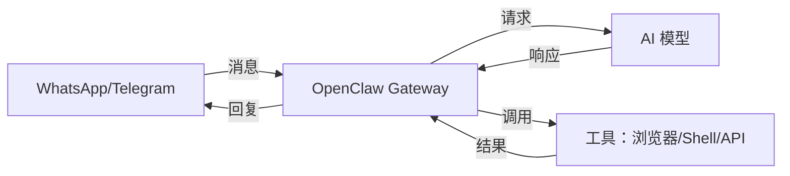
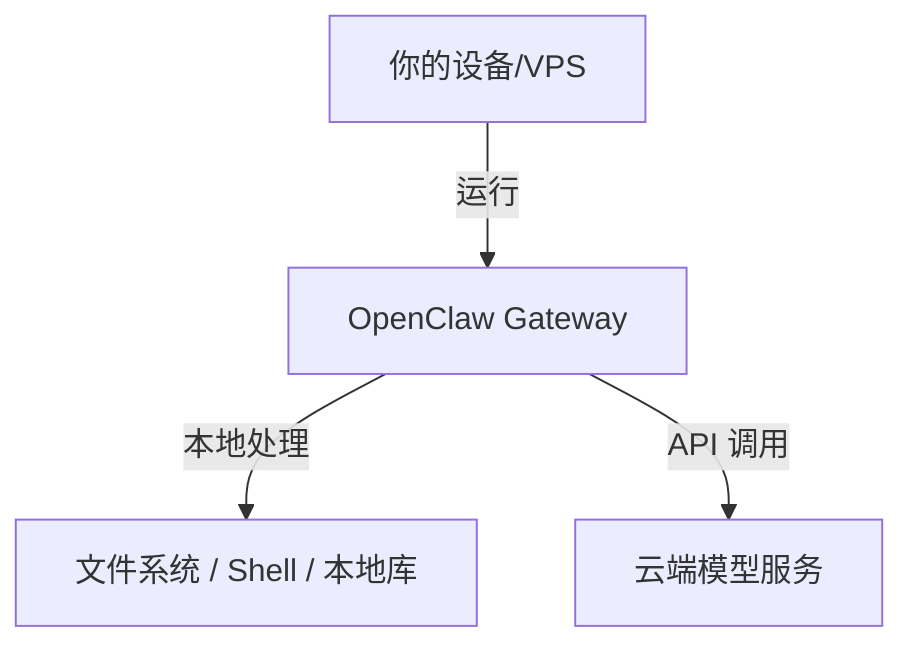
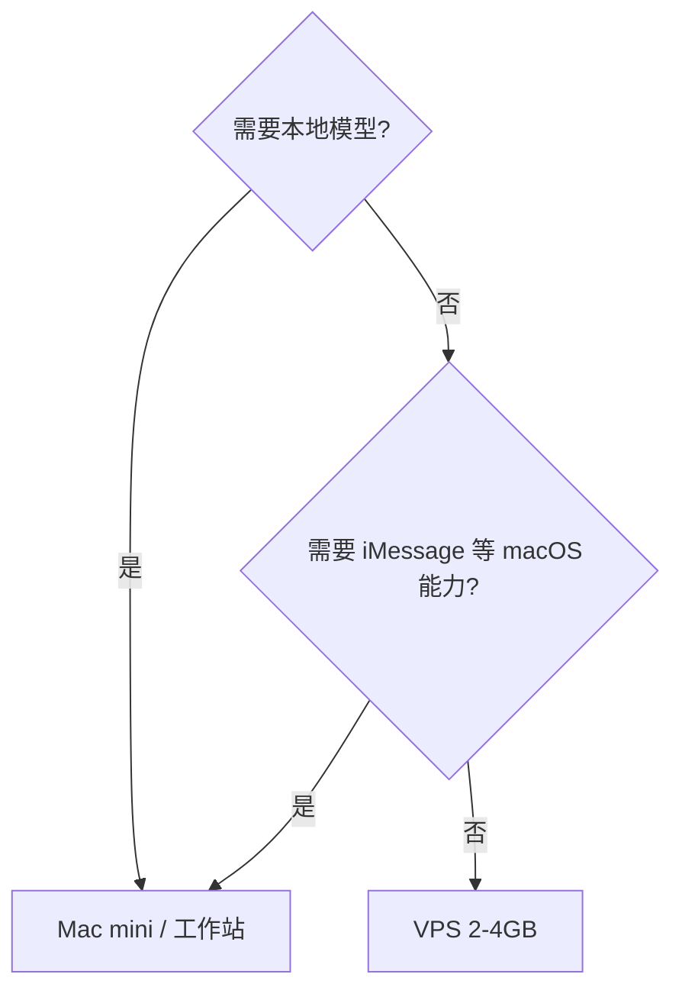

# OpenClaw Open-Source AI Assistant Deployment Guide

Send "clean up the desktop" on your phone, and a machine on the server actually executes it, then the result comes back to the chat window—this is the target form of OpenClaw. It is a self-hosted message-first assistant; the gateway process runs on your machine, memory is stored as local Markdown files, and model calls use the API Key you configure yourself.

The following sections cover architecture, memory structure, platform integration, installation and configuration, persistent running and scheduling, hardware selection, and how to constrain permissions.

## First, establish three judgments

1. **No cloud control plane**: All logic is in the local process; when the machine is off, it is offline
2. **Hardware depends on whether you need local models**: If you only use APIs, a 2C2G VPS is enough; local inference is what requires hardware like a Mac mini
3. **It has the permissions of your account**: Isolate first, then add features; do not deploy it for the first time on a host with production data

## 1. What problem it solves

Web-based chat products require you to open them and ask questions proactively; when the conversation ends, the context is gone. Putting an assistant into a messaging app changes two things:

- **Entry point**: No need to switch apps; talk directly in Telegram/WhatsApp, and voice messages can also be converted to text
- **Proactivity**: The gateway checks conditions on a cron schedule and proactively sends a message when they are met, without requiring you to be present

The cost is permissions. It needs to execute shell commands, read and write files, and call external APIs on the local machine. These capabilities also mean that the consequences of misoperations and prompt injection are borne by you.

| Dimension | Web chat | OpenClaw |
|---|---|---|
| Entry point | Open a website or app | Everyday messaging apps |
| Memory | Single session | Long-term local file storage |
| Proactivity | Passively waits for instructions | Proactive cron push |
| Data location | Vendor cloud | Your own machine |

## 2. Architecture: The gateway is the orchestrator

```
消息应用 ⇄ OpenClaw Gateway ⇄ AI 模型 + 工具
```



Path of a request:

1. A message comes in from the platform; the gateway performs authentication (whether it is a user in the allowlist)
2. Assemble context: system prompt, relevant memory files, available tools
3. Call the model; if the model returns tool calls, execute them, feed the results back, and loop until it no longer calls tools
4. The output returns to the original conversation thread

The reason it is called a gateway is that it manages four things at once: a multi-platform inbox, conversation state, scheduled tasks, and connections to external services. Proactive notifications are "cron triggers → goes through the same reasoning chain → delivered to the specified conversation."

Data boundary when running locally:



Model calls still go out to the network unless you switch to a local model; messages, memory, and script configuration stay on the local machine.

## 3. Memory: Files are state

Memory is a set of Markdown files in a directory, not a database:

```
~/.openclaw/
├── memory/
│   ├── 2026-01-20-daily.md
│   └── 2026-01-26-daily.md
├── preferences.md
└── context.md
```

Daily notes record what happened that day; `preferences.md` and `context.md` record long-term preferences and background.

```markdown
# 2026-01-26 Daily Memory

## Conversations
- 讨论了 OpenClaw 安装
- 配好了 Telegram 接入

## Key Information
- 简报时间偏好：早上 8 点
- 常用工具：Notion、Todoist、Gmail

## Tasks Completed
- [x] 配置每日简报
- [x] 接入日历
```

Practical benefits of this design: you can open it directly with Obsidian, search it with grep, version it with git, and package it and go. The risks are also direct—files will pile up, and in long-context scenarios you need to regularly clean up outdated entries.

## 4. Platform integration

| Platform | Notes |
|---|---|
| Telegram | Simplest to configure, first choice for beginners |
| WhatsApp | Good mobile experience, requires QR code binding |
| Discord / Slack | Team scenarios |
| iMessage | Depends on BlueBubbles, requires an always-on Mac |
| Signal | Privacy-first |
| Matrix / Teams | Self-hosted or enterprise environments |

Multiple platforms can be connected at the same time and share the same memory. For group chats, be sure to set trigger rules first; otherwise every message will enter inference.

## 5. Installation and configuration

```bash
# macOS / Linux
curl -fsSL https://openclaw.ai/install.sh | bash
```

The installation script creates the `~/.openclaw` directory and enters the configuration wizard, where you select the model provider, enter the API Key, and choose the messaging platform in sequence.

Steps for Telegram integration:

```bash
# 1. 在 Telegram 里找 @BotFather，发送 /newbot，拿到 token
# 2. 把 token 填进向导
# 3. 给自己的 bot 发一条消息，然后取 chat_id
curl "https://api.telegram.org/bot<TOKEN>/getUpdates"
```

The configuration file is at `~/.openclaw/openclaw.json`, logs are in `~/.openclaw/logs/`, and memory is in `~/.openclaw/memory/`. After installation, first send "What can you do" to verify the link, then add integrations.

## 6. Persistent running and scheduling

On a VPS, hand it to systemd so the process is automatically restarted if it crashes:

```ini
# /etc/systemd/system/openclaw-gateway.service
[Unit]
Description=OpenClaw Gateway
After=network-online.target
Wants=network-online.target

[Service]
ExecStart=/usr/local/bin/openclaw gateway --port 18789
Restart=always
RestartSec=5
KillMode=control-group

[Install]
WantedBy=multi-user.target
```

```bash
sudo systemctl daemon-reload
sudo systemctl enable --now openclaw-gateway.service
sudo systemctl status openclaw-gateway
```

Scheduled tasks can be done in two ways: system crontab calling scripts, or using the gateway's built-in scheduler. System crontab is more stable and easier to inspect, suitable for fixed scripts:

```bash
# 每天 8 点简报，每周五 17 点周报
0 8 * * *  ~/.openclaw/skills/daily-briefing.sh
0 17 * * 5 ~/.openclaw/skills/weekly-summary.sh
```

In scripts, it is recommended to fix `cd` to the working directory and explicitly load environment variables—cron's environment is different from your login shell's environment, and this is the most common "works manually, does not run on schedule" issue.

## 7. Hardware and cost

Photos of "a bunch of Mac minis running OpenClaw" can easily make people think they must buy a Mac. The decision order is: whether you need local models → whether you need macOS-exclusive capabilities → if neither is needed, use a VPS.



| Scenario | Recommended configuration |
|---|---|
| Messages + API calls | VPS 2GB |
| Add automation scripts | VPS 4GB |
| Add browser automation | VPS 8GB or local machine |
| Local LLM | Mac mini M4 or workstation |

Actual reasons to choose a Mac mini: low power consumption (about $2 per month in electricity if left on year-round), fanless and silent, can run MLX-optimized local models, and iMessage and Apple Notes are directly usable.

Cost structure:

| Item | Monthly cost |
|---|---|
| Software | $0 (open source) |
| Local running | $0 |
| Basic VPS | $5-10 |
| API (light) | $10-20 |
| API (heavy) | $50-100+ |

A cost-saving approach is tiered calls: assign classification, summarization, and formatting to cheap models, and use strong models only for tasks that require planning or multi-step reasoning.

## 8. Security

It can delete files, execute commands, and send messages, so assume by default that it will make mistakes.

**Runtime environment**

- A separate VPS or virtual machine; do not install it on a host with production data
- Run it as a dedicated low-privilege user, not as root
- When running in Docker, mount the minimum directories, with read-only preferred

```dockerfile
FROM node:22-alpine
RUN addgroup -S openclaw && adduser -S openclaw -G openclaw
WORKDIR /app
COPY --chown=openclaw:openclaw . .
RUN npm install
USER openclaw
```

**Permission reduction**

- Command allowlist: only allow things like `git`, `npm`, and `curl` that are actually needed
- Directory allowlist: no writes outside the working directory; explicitly deny `/etc` and `/root`
- Dangerous operations require manual confirmation; do not provide a global "auto-approve" switch

**Secrets**

```bash
# 环境变量 + 600 权限，别写进仓库
echo "ANTHROPIC_API_KEY=..." > ~/.openclaw/.env
chmod 600 ~/.openclaw/.env
```

**Network surface**

Do not expose the gateway port directly to the public internet. For remote access, use an SSH tunnel or a reverse proxy with authentication; restrict outbound traffic as needed, allowing only model API and messaging platform domains.

```bash
sudo ufw default deny incoming
sudo ufw allow from <你的IP> to any port 18789
```

**Privacy**

Prompts sent to cloud models contain your memory content. Switch to a local model for sensitive tasks, regularly clean up expired entries in `memory/`, and set log retention to be shorter as needed.

## 9. Suitable and unsuitable

| Situation | Conclusion |
|---|---|
| Knows the command line and wants to automate daily tasks | Suitable; start with a single platform and a single model |
| Privacy-sensitive and able to self-host | Suitable; configure a local model |
| Completely non-technical users | Not suitable; the configuration barrier is the terminal |
| Requires SLA and compliance certification | Not suitable; the project iterates quickly and has no formal support |
| Zero budget | Not suitable; model APIs are an ongoing expense |

For the first deployment, keep it to no more than three things: one platform, one model, and one scheduled task. Run it for a week, then decide what to add.

## References

- [OpenClaw official website](https://openclaw.ai/)
- [OpenClaw GitHub repository](https://github.com/openclaw/openclaw)
- [Installation video tutorial](https://www.youtube.com/watch?v=Qkqe-uRhQJE)
- [Community Discord](https://discord.gg/openclaw)