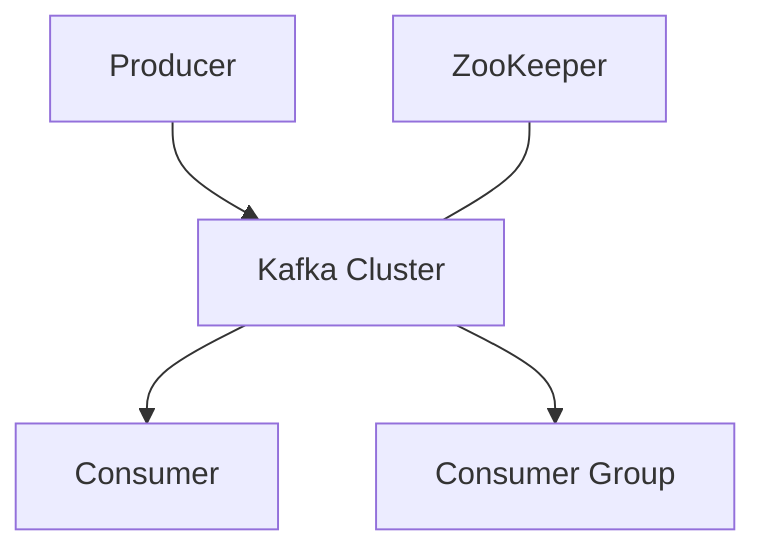

# Deep Dive into Kafka Principles: A High-Performance Distributed Stream Processing Platform

## 1. Kafka Introduction

Apache Kafka is a distributed stream processing platform known for its high throughput, scalability, and fault tolerance. It was originally developed by LinkedIn and has now become the industry standard for processing real-time data streams.

## 2. Core Concepts

Before diving into Kafka's principles, we need to understand several key concepts:

- **Topic**: Logical classification of messages
- **Partition**: Physical shard of a Topic
- **Producer**: Message producer
- **Consumer**: Message consumer
- **Broker**: Kafka server
- **ZooKeeper**: Used to coordinate the Kafka cluster (Note: newer versions are removing the ZooKeeper dependency)

## 3. Architecture Design

Kafka's architecture can be represented by the following diagram:



This simplified architecture diagram shows Kafka's main components and their relationships.

## 4. How It Works

### 4.1 Message Storage

Kafka's core is an append-only log-based storage system. Each partition is an ordered, immutable sequence of messages.

#### Log Structure
- Each partition consists of multiple log segments (LogSegment)
- Each log segment corresponds to a file, and a new log segment is created after a certain size is reached
- Messages are appended to the currently active log segment

```java
public class LogSegment {
    private File file;
    private FileChannel channel;
    private long baseOffset;
    
    public void append(Record record) throws IOException {
        ByteBuffer buffer = record.serialize();
        channel.write(buffer);
    }
}
```

#### Index Mechanism
Kafka maintains two types of indexes for each log segment:
- Offset index: maps message offsets to physical positions in the file
- Timestamp index: maps timestamps to message offsets

These indexes accelerate the message lookup process.

### 4.2 Message Production

#### Partition Selection
When a producer sends a message, it selects a partition according to the following rules:
1. If a partition is specified, use it directly
2. If no partition is specified but a key is present, hash the key to select a partition
3. If neither a partition nor a key is specified, select a partition in round-robin fashion

```java
public class DefaultPartitioner implements Partitioner {
    public int partition(String topic, Object key, byte[] keyBytes, Object value, byte[] valueBytes, Cluster cluster) {
        List<PartitionInfo> partitions = cluster.partitionsForTopic(topic);
        int numPartitions = partitions.size();
        if (keyBytes == null) {
            int nextValue = nextValue(topic);
            List<PartitionInfo> availablePartitions = cluster.availablePartitionsForTopic(topic);
            if (availablePartitions.size() > 0) {
                int part = Utils.toPositive(nextValue) % availablePartitions.size();
                return availablePartitions.get(part).partition();
            } else {
                return Utils.toPositive(nextValue) % numPartitions;
            }
        } else {
            return Utils.toPositive(Utils.murmur2(keyBytes)) % numPartitions;
        }
    }
}
```

#### Message Sending
1. The producer serializes the message
2. Selects the target partition according to the partitioning strategy
3. Adds the message to an in-memory batch
4. A background thread periodically sends the batch to the corresponding Broker

### 4.3 Message Replication

Kafka uses a leader-follower replication mechanism to ensure data reliability:
1. Each partition has one leader and multiple followers
2. All read and write operations go through the leader
3. Followers replicate data by sending fetch requests to the leader
4. The ISR (In-Sync Replicas) mechanism ensures that only followers that have kept up with the leader can be elected as the new leader

```java
public class ReplicaManager {
    public void replicateFromLeader(TopicPartition partition, long fetchOffset) {
        Broker leaderBroker = getLeaderBroker(partition);
        FetchRequest request = new FetchRequest(partition, fetchOffset);
        FetchResponse response = leaderBroker.fetch(request);
        appendToLocalLog(response.getRecords());
    }
}
```

### 4.4 Message Consumption

#### Consumer Group
- Consumers in the same group collectively consume messages from a topic
- Each partition can be consumed by only one consumer within the group
- The number of consumers should not exceed the number of partitions; otherwise, some consumers will be idle

#### Offset Management
- Kafka uses the consumer offset to record consumption progress
- Offsets are stored in the internal topic `__consumer_offsets`
- Consumers can choose to commit offsets automatically or manually

```java
public class KafkaConsumer<K, V> {
    public void commitSync() {
        Map<TopicPartition, OffsetAndMetadata> offsets = currentOffsets.entrySet().stream()
            .collect(Collectors.toMap(
                Map.Entry::getKey,
                e -> new OffsetAndMetadata(e.getValue())
            ));
        commitSync(offsets);
    }
}
```

### 4.5 Message Delivery

Kafka uses zero-copy technology to efficiently transfer messages from the file system to the network:

```java
public class ZeroCopyFileReader {
    public long sendFile(FileChannel fileChannel, SocketChannel socketChannel, long position, long count) throws IOException {
        return fileChannel.transferTo(position, count, socketChannel);
    }
}
```

This approach avoids multiple data copies between user space and kernel space, significantly improving performance.

### 4.6 Replica Synchronization and Leader Election

#### ISR (In-Sync Replicas) Mechanism
- ISR contains all replicas that are in sync with the leader (including the leader itself)
- Only replicas in the ISR are eligible to be elected as the new leader
- Replicas that fall too far behind are removed from the ISR

#### Leader Election
When the leader replica fails:
1. The controller detects the leader failure
2. Selects the first active replica from the ISR as the new leader
3. Other followers begin synchronizing data from the new leader

```java
public class ControllerContext {
    public void electNewLeader(TopicPartition partition) {
        List<Integer> isr = inSyncReplicas(partition);
        for (int brokerId : isr) {
            if (isAlive(brokerId)) {
                setNewLeader(partition, brokerId);
                break;
            }
        }
    }
}
```

### 4.7 Data Cleanup

Kafka provides two data cleanup strategies:
1. Time-based deletion: retain data within a specific time period
2. Size-based deletion: retain data up to a specific size

For key-value storage scenarios, Kafka also provides log compaction, which retains only the latest value for each key.

```java
public class LogCleaner {
    public void clean(TopicPartition partition) {
        Map<String, Record> latestRecordPerKey = new HashMap<>();
        for (Record record : readPartition(partition)) {
            latestRecordPerKey.put(record.key(), record);
        }
        writeCompactedLog(partition, latestRecordPerKey.values());
    }
}
```

## 5. Performance Optimization

Kafka's high performance comes from several carefully designed features:

1. **Sequential I/O**: Maximizes disk performance through sequential writes and batch reads.

2. **Zero-copy**: Transfers data directly from the file system cache to the network buffer, avoiding unnecessary data copies.

3. **Batching**: Both producers and consumers support message batching, improving throughput.

4. **Compression**: Supports multiple compression algorithms, reducing network transmission and storage overhead.

5. **Partition parallelism**: Topic partitions enable parallel processing and load balancing.

## 6. Practical Tips

1. **Set the number of partitions appropriately**: Too few partitions may lead to insufficient parallelism, while too many increase overhead. Set it based on expected throughput and the number of consumers.

2. **Monitor key metrics**: Such as producer and consumer latency, Broker disk usage, etc.

3. **Clean up logs regularly**: Use log cleanup policies to avoid unlimited disk usage.

4. **Optimize producer configuration**:

   ```java
   Properties props = new Properties();
   props.put("batch.size", 16384);
   props.put("linger.ms", 1);
   props.put("compression.type", "snappy");
   ```

5. **Use keys to guarantee message ordering**: Messages with the same key are sent to the same partition.

## 7. Conclusion

Kafka's design philosophy and implementation details make it an ideal choice for processing large-scale real-time data streams. By deeply understanding Kafka's principles, developers can better leverage its features to build efficient and reliable distributed systems.