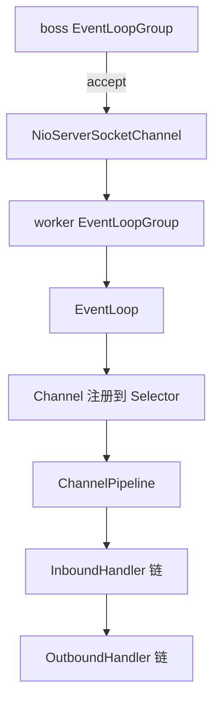

# Netty's Event Loop, Pipeline, and Zero-Copy

When writing a service directly with NIO, you have to handle everything yourself: empty polling on the `Selector`, partial and coalesced TCP packets, write-buffer backlog, and connections that break and are left unclosed. Netty folds these into three abstractions—`EventLoop`, `Pipeline`, and `ByteBuf`—at the cost of having to understand its thread model; otherwise, a single database query in `channelRead` will stall hundreds of connections on the entire EventLoop.

Below, we follow the lifecycle of a single connection: first the responsibilities of the components, then the `NioEventLoop` loop, its correspondence to Reactor, and Pipeline event propagation; next, ByteBuf and the four forms of zero-copy; finally, several common configuration mistakes.

## Components and Responsibilities

| Component | Responsibility | Notes |
|---|---|---|
| `Channel` | Read/write abstraction for a connection | Implementations such as `NioSocketChannel` |
| `EventLoop` | A thread that runs I/O and a task queue | One EventLoop can handle multiple Channels |
| `EventLoopGroup` | Pool that manages EventLoops | Usually split into boss/worker |
| `ChannelPipeline` | Ordered chain of Handlers | Inbound and outbound directions are opposite |
| `ByteBuf` | Byte container | Has separate read/write indexes and can be pooled |

`ChannelFuture` carries an asynchronous result; `ChannelPromise` is the writable version used to fill in success or failure within a flow.

## 1. Data Flow After a Connection Is Established



1. An EventLoop in the boss group handles `OP_ACCEPT` and obtains the new connection.
2. The new `Channel` is assigned an EventLoop from the worker group and registered with that EventLoop's `Selector`.
3. Inbound data enters at the head of the Pipeline and passes through `ChannelInboundHandler` instances in order.
4. `ctx.write()` generates an outbound event, which travels backward from the current Handler toward the tail of the Pipeline and is encoded by `ChannelOutboundHandler` instances before being written out.

The direction in step 4 is easy to misremember: inbound is head → tail, outbound is tail → head, and it starts from the **current node** rather than from the head. So if you call `ctx.write()` in a Handler somewhere in the middle, it will pass through the preceding outbound Handlers.

## 2. Reactor and EventLoop

### Classic Reactor Structure

Netty's model is a variant of Reactor: one Acceptor accepts connections, and multiple Handlers handle I/O.

```java
public class Reactor implements Runnable {
    final Selector selector;
    final ServerSocketChannel serverSocket;

    Reactor(int port) throws IOException {
        selector = Selector.open();
        serverSocket = ServerSocketChannel.open();
        serverSocket.socket().bind(new InetSocketAddress(port));
        serverSocket.configureBlocking(false);
        SelectionKey sk = serverSocket.register(selector, SelectionKey.OP_ACCEPT);
        sk.attach(new Acceptor());
    }

    public void run() {
        try {
            while (!Thread.interrupted()) {
                selector.select();
                Iterator<SelectionKey> it = selector.selectedKeys().iterator();
                while (it.hasNext()) {
                    dispatch(it.next());
                    it.remove();          // 必须移除，否则下次仍是就绪状态
                }
            }
        } catch (IOException ex) { /* ... */ }
    }

    void dispatch(SelectionKey k) {
        Runnable r = (Runnable) k.attachment();
        if (r != null) {
            r.run();
        }
    }

    class Acceptor implements Runnable {
        public void run() {
            try {
                SocketChannel c = serverSocket.accept();
                if (c != null) {
                    new Handler(selector, c);
                }
            } catch (IOException ex) { /* ... */ }
        }
    }
}
```

Mapped to Netty:

| Classic Reactor | Netty |
|---|---|
| `Reactor` | `NioEventLoop` |
| `Acceptor` | The accept branch in `NioMessageUnsafe.read` |
| `Handler` | A group of Handlers in `ChannelPipeline` |

`ChannelInitializer` does not handle accept; it only installs Handlers into the Pipeline after the Channel has been registered. Conflating the two will send you in the wrong direction when troubleshooting “the connection came in but no Handler was called.”

### The Main Loop of NioEventLoop

One iteration of `run()` does only three things:

```java
protected void run() {
    for (;;) {
        try {
            select();               // 等就绪事件，同时兼顾定时任务
            processSelectedKeys();  // 处理 I/O
            runAllTasks();          // 跑队列里的任务
        } catch (Throwable t) {
            handleLoopException(t);
        }
    }
}
```

Two things in `select()` are worth noting:

- The timeout passed in is the remaining time until the nearest scheduled task (`delayNanos`), so tasks submitted via `schedule` are not delayed by blocking in `select`.
- If consecutive empty returns exceed a threshold (`MIN_PREMATURE_SELECTOR_RETURNS`, default 512), `rebuildSelector()` is called to replace the `Selector` with a new one. This works around a JDK bug with epoll empty polling on Linux, whose symptom is one CPU core pegged at 100% while traffic remains normal.

`runAllTasks()` first transfers due scheduled tasks once, then executes them in a deadline-bounded manner, checking for timeout every 64 tasks:

```java
if ((runTasks & 0x3F) == 0) {
    lastExecutionTime = ScheduledFutureTask.nanoTime();
    if (lastExecutionTime >= deadline) {
        break;
    }
}
```

The limit is there so the task queue does not starve I/O. But if a **single** task runs for a long time, the limit becomes ineffective—this is why making a synchronous RPC call in `channelRead` can stall an entire group of connections.

### Branches in processSelectedKeys

```java
int readyOps = k.readyOps();
if ((readyOps & SelectionKey.OP_CONNECT) != 0) {
    int ops = k.interestOps();
    k.interestOps(ops & ~SelectionKey.OP_CONNECT);  // 连上后取消关注，否则一直触发
    unsafe.finishConnect();
}
if ((readyOps & SelectionKey.OP_WRITE) != 0) {
    ch.unsafe().forceFlush();
}
if ((readyOps & (SelectionKey.OP_READ | SelectionKey.OP_ACCEPT)) != 0 || readyOps == 0) {
    unsafe.read();   // readyOps == 0 也要读一次，处理连接被对端关闭的情况
}
```

`OP_WRITE` is registered only when the write buffer has a backlog and is not watched otherwise—registering `OP_WRITE` on a `Selector` while the socket remains writable will cause busy spinning and saturate the CPU.

### Thread Model Constraints

- All events for the same `Channel` are handled by the same thread, so Handlers do not need locking.
- To write from another thread, use `channel.writeAndFlush()`; Netty wraps it as a task and submits it to the target EventLoop.
- The default number of EventLoop threads is `CPU cores × 2`; you can increase it for I/O-intensive workloads, and for pure forwarding it can run with the count reduced to the number of cores.
- Blocking operations should be offloaded to an application thread pool: `DefaultEventLoopGroup` is only suitable for running non-blocking CPU tasks; it provides no protection beyond thread isolation.

## 3. Pipeline and Handler

```java
public class EchoServerHandler extends ChannelInboundHandlerAdapter {
    @Override
    public void channelRead(ChannelHandlerContext ctx, Object msg) {
        ctx.write(msg);          // 不 flush，等一批读完统一刷
    }

    @Override
    public void channelReadComplete(ChannelHandlerContext ctx) {
        ctx.flush();
    }

    @Override
    public void exceptionCaught(ChannelHandlerContext ctx, Throwable cause) {
        ctx.close();
    }
}
```

A few conventions:

- `ctx.write()` propagates from the current Handler in the outbound direction; `channel.write()` starts from the tail of the Pipeline.
- If `msg` is a `ByteBuf`, it must be released after use; `SimpleChannelInboundHandler` releases it automatically, while `ChannelInboundHandlerAdapter` does not. The symptom of a missed release is off-heap memory growing continuously until `OutOfDirectMemoryError`.
- To propagate an exception, either call `ctx.fireExceptionCaught(cause)` or handle it yourself; swallowing an exception leaves the connection half-dead.
- Place codecs near the front of the Pipeline; frame decoders such as `LengthFieldBasedFrameDecoder` must come before business Handlers.

## 4. ByteBuf

`ByteBuf` is an abstract class; do not `new` it directly—create it with `Unpooled` or an allocator:

```java
ByteBuf buf = ctx.alloc().buffer(256);      // 跟随 Channel 的分配器（默认池化）
buf.writeInt(1);
buf.writeBytes(payload);

int id = buf.readInt();                     // readerIndex 前移
int readable = buf.readableBytes();          // writerIndex - readerIndex
buf.release();                               // 引用计数归零才真正归还内存
```

Differences from `ByteBuffer`:

- Separate read and write indexes; switching between reading and writing does not require `flip()`.
- Capacity expands on demand; `ensureWritable()` grows it automatically.
- Managed by reference counting; pooled allocation relies on it for return, and forgetting `release()` means a leak.
- `slice()` / `duplicate()` share the underlying memory without copying data.

Pooling has been the default since 4.1 (`PooledByteBufAllocator`); explicitly setting it only makes sense when you need to change the allocation strategy:

```java
// 服务端：option 作用于父 Channel（监听 socket），childOption 作用于每条连接
b.childOption(ChannelOption.ALLOCATOR, PooledByteBufAllocator.DEFAULT);
b.childOption(ChannelOption.TCP_NODELAY, true);
```

Writing `option(ChannelOption.ALLOCATOR, ...)` only affects the listening socket and has no effect on application connections—this is a classic case of configuration that “looks like it took effect but actually did not.”

## V. The Four Forms of Zero-Copy

In Netty, "zero-copy" refers to four different things. Lumping them together leads to misdiagnosing performance bottlenecks:

| Form | Approach | What It Saves |
|---|---|---|
| Off-heap buffer | Read directly into `DirectByteBuf` | One copy from heap to off-heap |
| Composite buffer | `CompositeByteBuf` combines multiple `ByteBuf`s | The full-segment copy during merging |
| Slicing and views | `slice()` / `duplicate()` | Data copying during splitting |
| File transfer | `FileRegion` + `transferTo` | Copies between user space and kernel space |

The first three only eliminate copying inside the JVM; only the last one involves zero-copy at the system-call level. `FileRegion` relies on `sendfile` and is unavailable when TLS is enabled (encryption requires reading data into user space), in which case you can only fall back to `ChunkedFile`.

```java
// 组合缓冲：把 header 和 body 合成一个逻辑上的连续缓冲
CompositeByteBuf composite = Unpooled.compositeBuffer();
composite.addComponents(true, header, body);   // true 表示自动调整 writerIndex
```

## VI. Common Configuration and Troubleshooting

- **Write buffer watermarks**: The default high/low watermarks of `WriteBufferWaterMark` are 32KB / 64KB. When `channel.isWritable()` turns false, you should slow down. In slow-consumer scenarios, raise them; otherwise `writeAndFlush` keeps piling up until OOM.
- **Connection idle detection**: `IdleStateHandler` read-idle detection must be paired with an application-level heartbeat; adding the handler without sending heartbeats is meaningless.
- **`SO_BACKLOG`**: The default is on the small side; under high-concurrency connection establishment it can be raised to 1024.
- **`TCP_NODELAY`**: Enabled by default in Netty; there is no need to disable it for small packets.
- **Shutdown order**: `shutdownGracefully()` stops accepting new tasks before exiting; do not use `shutdownNow()`.

| Symptom | Common Cause |
|---|---|
| One CPU core at 100% with normal traffic | epoll busy-spinning; check whether `rebuildSelector` is triggered |
| Off-heap memory grows until OOM | `ByteBuf` not `release()`d |
| Slowing business processing drags down all connections | Blocking calls made in the EventLoop |
| Client receives no data and no error is reported | Write buffer is full but `isWritable()` is not checked |

## Related Reading

- [JNA: Calling Native Libraries from Java](/en/backend/jna): how to integrate when you need to reach down to a native library
- [Kafka Storage and Replication Mechanisms](/en/backend/kafka): the network-layer implementation of a messaging system
- [Spring Container, AOP, and Declarative Transactions](/en/backend/spring): threads and lifecycle inside the container