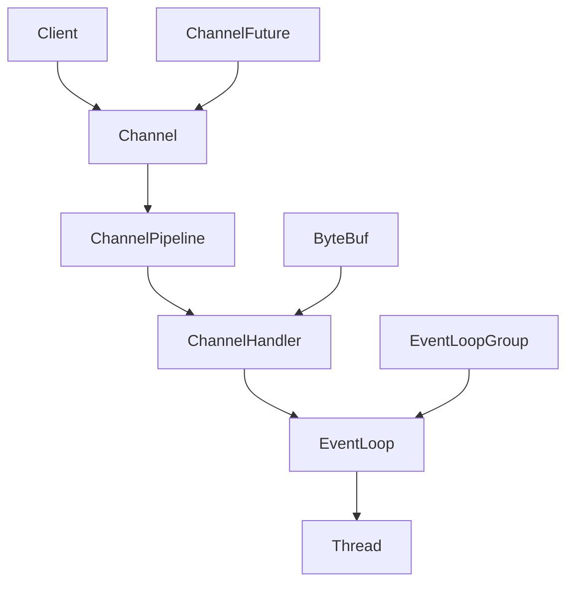

# In-Depth Analysis of Netty Principles: A High-Performance Network Application Framework

## 1. Introduction to Netty

Netty is an asynchronous event-driven network application framework for rapidly developing maintainable high-performance protocol servers and clients. It greatly simplifies network programming such as TCP and UDP socket servers.

## 2. Core Concepts

Before diving into Netty principles, we need to understand several key concepts:

- **Channel**: An abstraction of a network socket
- **EventLoop**: The core abstraction for handling I/O operations
- **ChannelPipeline**: A chain that handles or intercepts inbound and outbound events
- **ChannelHandler**: An interface for handling I/O events or intercepting I/O operations
- **ByteBuf**: An efficient byte container

## 3. Architecture Design

Netty's architecture design is key to its high performance and flexibility. Below is Netty's core architecture diagram and detailed explanation:



### 3.1 Core Component Analysis

1. **Channel**
   - Represents an abstraction of a network connection
   - Responsible for network I/O operations such as read, write, connect, bind, etc.
   - Common implementations: NioSocketChannel, NioServerSocketChannel

2. **ChannelPipeline**
   - Contains a series of ChannelHandlers
   - Defines the pipeline for handling inbound and outbound events
   - Supports dynamically adding and removing ChannelHandlers

3. **ChannelHandler**
   - Handles I/O events or intercepts I/O operations
   - Converts data formats, handles exceptions, etc.
   - Divided into inbound handlers (ChannelInboundHandler) and outbound handlers (ChannelOutboundHandler)

4. **EventLoop**
   - The core for handling all I/O operations
   - Usually one EventLoop can handle multiple Channels
   - Ensures that all I/O events of a Channel are handled by the same Thread, avoiding synchronization issues

5. **EventLoopGroup**
   - Contains one or more EventLoops
   - Used to manage and assign EventLoops to Channels
   - Multiple EventLoopGroups can be configured as needed, such as separating I/O operations and time-consuming tasks

6. **ByteBuf**
   - Netty's data container, replacing Java NIO's ByteBuffer
   - Provides more flexible and efficient byte buffer operations
   - Supports pooling, reducing memory allocation and GC pressure

7. **ChannelFuture**
   - Represents the result of an asynchronous I/O operation
   - Provides methods such as adding listeners and waiting for operation completion
   - Used with ChannelPromise to set operation results

### 3.2 Data Flow Process

1. The client initiates a connection, and Netty creates a new Channel.
2. The Channel is associated with an EventLoop, which is responsible for handling all I/O events for this Channel.
3. Inbound data (such as a client request) enters the ChannelPipeline through the Channel.
4. The data passes sequentially through the ChannelInboundHandlers in the ChannelPipeline.
5. The processed data may be converted into outbound data (such as a server response).
6. The outbound data passes sequentially through the ChannelOutboundHandlers.
7. Finally, it is written back to the client through the Channel.

### 3.3 Design Advantages

1. **Highly modular**: Each component has clear responsibilities and is easy to extend and customize.
2. **Asynchronous and non-blocking**: Based on an event-driven model, it efficiently handles concurrent connections.
3. **Flexible threading model**: EventLoopGroups can be configured as needed to optimize resource usage.
4. **Zero-copy support**: Reduces data copying between kernel space and user space, improving performance.
5. **Rich protocol support**: Built-in multiple codecs make it easy to develop various network applications.

### 3.4 Example: Building a Server

The following code shows how to use Netty's core components to build a simple server:

```java
public class NettyServer {
    public static void main(String[] args) throws Exception {
        EventLoopGroup bossGroup = new NioEventLoopGroup(1);
        EventLoopGroup workerGroup = new NioEventLoopGroup();
        try {
            ServerBootstrap b = new ServerBootstrap();
            b.group(bossGroup, workerGroup)
             .channel(NioServerSocketChannel.class)
             .childHandler(new ChannelInitializer<SocketChannel>() {
                 @Override
                 public void initChannel(SocketChannel ch) throws Exception {
                     ch.pipeline().addLast(new EchoServerHandler());
                 }
             });

            ChannelFuture f = b.bind(8080).sync();
            f.channel().closeFuture().sync();
        } finally {
            workerGroup.shutdownGracefully();
            bossGroup.shutdownGracefully();
        }
    }
}
```
## 4. How It Works

### 4.1 Reactor Pattern

Netty's design is based on a variant of the Reactor pattern. In this pattern, the Acceptor plays a key role in accepting new connections. The following is the core implementation of the Reactor pattern.

```java
public class Reactor implements Runnable {
    final Selector selector;
    final ServerSocketChannel serverSocket;

    Reactor(int port) throws IOException {
        selector = Selector.open();
        serverSocket = ServerSocketChannel.open();
        serverSocket.socket().bind(new InetSocketAddress(port));
        serverSocket.configureBlocking(false);
        SelectionKey sk = serverSocket.register(selector, SelectionKey.OP_ACCEPT);
        sk.attach(new Acceptor());
    }

    public void run() {
        try {
            while (!Thread.interrupted()) {
                selector.select();
                Set<SelectionKey> selected = selector.selectedKeys();
                Iterator<SelectionKey> it = selected.iterator();
                while (it.hasNext()) {
                    dispatch(it.next());
                }
                selected.clear();
            }
        } catch (IOException ex) { /* ... */ }
    }

    void dispatch(SelectionKey k) {
        Runnable r = (Runnable)(k.attachment());
        if (r != null) {
            r.run();
        }
    }

    class Acceptor implements Runnable {
        public void run() {
            try {
                SocketChannel c = serverSocket.accept();
                if (c != null)
                    new Handler(selector, c);
            } catch (IOException ex) { /* ... */ }
        }
    }
}
```

#### Key Points of Acceptor Association

1. **Creation and attachment of Acceptor**
   - In the Reactor constructor, create a ServerSocketChannel and register it with the Selector.
   - Key line: `SelectionKey sk = serverSocket.register(selector, SelectionKey.OP_ACCEPT);`
   - Immediately after: `sk.attach(new Acceptor());`
   - Here, the Acceptor instance is attached to the SelectionKey of the ServerSocketChannel.

2. **Triggering of Acceptor**
   - In the Reactor run method, when select() returns, iterate over selectedKeys.
   - Process each ready SelectionKey through the dispatch method.
   - In the dispatch method, obtain the attached object (i.e., the Acceptor) from the SelectionKey and run it.

3. **Responsibilities of Acceptor**
   - When the Acceptor's run method is called, it accepts new connections: `SocketChannel c = serverSocket.accept();`
   - For each new connection, create a new Handler to handle subsequent I/O operations.

4. **Relationship with Netty**
   - In Netty, this pattern is further abstracted and optimized.
   - NioEventLoop corresponds to the Reactor here.
   - The ChannelInitializer configured in ServerBootstrap plays a role similar to the Acceptor.
   - After a new connection is accepted, the ChannelInitializer is responsible for setting up the ChannelPipeline, similar to creating a new Handler here.

#### Design Advantages

1. **Separation of responsibilities**: The Acceptor focuses on accepting new connections, while the Handler handles specific I/O operations.
2. **Scalability**: Multiple Reactor threads can easily be added to handle I/O operations while keeping a single Acceptor.
3. **Non-blocking design**: The entire process is non-blocking, improving the system's concurrent processing capability.
4. **Flexibility**: Through the attachment mechanism of SelectionKey, different handlers can be flexibly associated.

This design allows Netty to efficiently handle a large number of concurrent connections while maintaining a clear and maintainable code structure. The clever association of the Acceptor ensures that new connections can be quickly accepted and dispatched to the appropriate handlers, which is a key part of the efficient operation of the Reactor pattern.

### 4.2 EventLoop Thread Model

Netty's EventLoop is responsible for handling all I/O events and tasks. Its core logic includes selecting ready I/O events, processing these events, and running tasks in the queue.

```java
public final class NioEventLoop extends SingleThreadEventLoop {
    private final Selector selector;
    private final SelectorProvider provider;

    NioEventLoop(NioEventLoopGroup parent, ThreadFactory threadFactory, SelectorProvider selectorProvider) {
        super(parent, threadFactory, false);
        this.provider = selectorProvider;
        this.selector = openSelector();
    }

    protected void run() {
        for (;;) {
            try {
                select();
                processSelectedKeys();
                runAllTasks();
            } catch (Throwable t) {
                handleLoopException(t);
            }
        }
    }

    private void select() throws IOException {
        Selector selector = this.selector;
        try {
            int selectCnt = 0;
            long currentTimeNanos = System.nanoTime();
            long selectDeadLineNanos = currentTimeNanos + delayNanos(currentTimeNanos);
            for (;;) {
                long timeoutMillis = (selectDeadLineNanos - currentTimeNanos + 500000L) / 1000000L;
                if (timeoutMillis <= 0) {
                    if (selectCnt == 0) {
                        selector.selectNow();
                        selectCnt = 1;
                    }
                    break;
                }

                int selectedKeys = selector.select(timeoutMillis);
                selectCnt ++;

                if (selectedKeys != 0 || oldWakenUp || wakenUp.get() || hasTasks() || hasScheduledTasks()) {
                    break;
                }
                if (Thread.interrupted()) {
                    break;
                }

                currentTimeNanos = System.nanoTime();
                if (currentTimeNanos >= selectDeadLineNanos) {
                    selectCnt = 1;
                    break;
                }
            }

            if (selectCnt > MIN_PREMATURE_SELECTOR_RETURNS) {
                logger.warn("Selector.select() returned prematurely {} times in a row; rebuilding Selector {}.",
                        selectCnt, selector);
                rebuildSelector();
                selector = this.selector;
            }
        } catch (CancelledKeyException e) {
            // Harmless exception - log anyway
            logger.warn("Selector.select() threw CancelledKeyException.", e);
        }
    }

    private void processSelectedKeys() {
        Set<SelectionKey> selectedKeys = selector.selectedKeys();
        if (selectedKeys.isEmpty()) {
            return;
        }
        Iterator<SelectionKey> i = selectedKeys.iterator();
        for (;;) {
            final SelectionKey k = i.next();
            final Object a = k.attachment();
            i.remove();
            if (a instanceof AbstractNioChannel) {
                processSelectedKey(k, (AbstractNioChannel) a);
            } else {
                @SuppressWarnings("unchecked")
                NioTask<SelectableChannel> task = (NioTask<SelectableChannel>) a;
                processSelectedKey(k, task);
            }
            if (!i.hasNext()) {
                break;
            }
        }
    }

    private void processSelectedKey(SelectionKey k, AbstractNioChannel ch) {
        final AbstractNioChannel.NioUnsafe unsafe = ch.unsafe();
        if (!k.isValid()) {
            unsafe.close(unsafe.voidPromise());
            return;
        }

        try {
            int readyOps = k.readyOps();
            if ((readyOps & SelectionKey.OP_CONNECT) != 0) {
                int ops = k.interestOps();
                ops &= ~SelectionKey.OP_CONNECT;
                k.interestOps(ops);
                unsafe.finishConnect();
            }
            if ((readyOps & SelectionKey.OP_WRITE) != 0) {
                ch.unsafe().forceFlush();
            }
            if ((readyOps & (SelectionKey.OP_READ | SelectionKey.OP_ACCEPT)) != 0 || readyOps == 0) {
                unsafe.read();
            }
        } catch (CancelledKeyException ignored) {
            unsafe.close(unsafe.voidPromise());
        }
    }

    protected boolean runAllTasks(long timeoutNanos) {
        fetchFromScheduledTaskQueue();
        Runnable task = pollTask();
        if (task == null) {
            return false;
        }

        final long deadline = ScheduledFutureTask.nanoTime() + timeoutNanos;
        long runTasks = 0;
        long lastExecutionTime;
        for (;;) {
            try {
                task.run();
            } catch (Throwable t) {
                logger.warn("A task raised an exception.", t);
            }

            runTasks++;
            if ((runTasks & 0x3F) == 0) {
                lastExecutionTime = ScheduledFutureTask.nanoTime();
                if (lastExecutionTime >= deadline) {
                    break;
                }
            }

            task = pollTask();
            if (task == null) {
                lastExecutionTime = ScheduledFutureTask.nanoTime();
                break;
            }
        }

        return true;
    }
}
```

#### processSelectedKeys() Analysis

1. **Get selected keys**: Get all ready SelectionKeys from the selector.

2. **Iterate and process**: Process each SelectionKey.

3. **Identify attached object**: Check the attached object of the SelectionKey, which may be a Channel or NioTask.

4. **Handle I/O events**: 
   - For the connect completion event (OP_CONNECT), complete the connection process.
   - For the writable event (OP_WRITE), perform a forced flush.
   - For the readable event (OP_READ) or accept connection event (OP_ACCEPT), perform a read operation.

5. **Exception handling**: If a CancelledKeyException is encountered, close the related Channel.

#### runAllTasks() Analysis

1. **Task acquisition**: Get tasks from the scheduled task queue and poll the normal task queue.

2. **Execute tasks**: Execute as many tasks as possible within the specified time.

3. **Time control**: Use a deadline to control the total task execution time and prevent long-term occupation of the EventLoop.

4. **Periodic check**: After every 64 tasks are executed, check whether the timeout has been exceeded.

5. **Exception handling**: Catch and log exceptions during task execution to ensure that an exception in one task does not affect the execution of other tasks.

This design ensures that the EventLoop can efficiently handle I/O events and execute tasks while maintaining reasonable use of system resources. By alternately processing I/O events and executing tasks in a single loop, Netty implements an efficient event-driven model that can quickly respond to network events while processing related business logic.

### 4.3 Zero Copy

Netty achieves zero copy by using direct memory buffers and low-level optimizations, improving data transfer efficiency.

```java
public abstract class AbstractNioChannel extends AbstractChannel {
    protected final int doReadBytes(ByteBuf byteBuf) throws Exception {
        final RecvByteBufAllocator.Handle allocHandle = unsafe().recvBufAllocHandle();
        allocHandle.attemptedBytesRead(byteBuf.writableBytes());
        return byteBuf.writeBytes(javaChannel(), allocHandle.attemptedBytesRead());
    }
}
```

### 4.4 ChannelPipeline

ChannelPipeline provides a powerful mechanism for handling inbound and outbound events.

```java
public class EchoServerHandler extends ChannelInboundHandlerAdapter {
    @Override
    public void channelRead(ChannelHandlerContext ctx, Object msg) {
        ctx.write(msg);
    }

    @Override
    public void channelReadComplete(ChannelHandlerContext ctx) {
        ctx.flush();
    }

    @Override
    public void exceptionCaught(ChannelHandlerContext ctx, Throwable cause) {
        cause.printStackTrace();
        ctx.close();
    }
}
```

### 4.5 ByteBuf

Netty's ByteBuf is a powerful byte container that overcomes some limitations of Java NIO ByteBuffer.

```java
public final class ByteBuf {
    private final byte[] array;
    private int readerIndex;
    private int writerIndex;

    public ByteBuf(int capacity) {
        array = new byte[capacity];
    }

    public ByteBuf writeBytes(byte[] src) {
        int length = src.length;
        ensureWritable(length);
        System.arraycopy(src, 0, array, writerIndex, length);
        writerIndex += length;
        return this;
    }

    public ByteBuf readBytes(byte[] dst) {
        int length = dst.length;
        checkReadableBytes(length);
        System.arraycopy(array, readerIndex, dst, 0, length);
        readerIndex += length;
        return this;
    }
}
```

## 5. Performance Optimization

Netty's high performance stems from multiple carefully designed features:

1. **Asynchronous non-blocking I/O**: Based on Java NIO, it implements an efficient event-driven model.

2. **Zero copy**: Uses direct memory buffers to reduce the number of data copies.

3. **Memory pool**: Reduces memory allocation and GC pressure by reusing ByteBuf.

4. **Efficient protocol encoding/decoding**: Provides rich codecs, such as protobuf, thrift, etc.

5. **Flexible thread model**: EventLoopGroup can be configured according to requirements.

## 6. Practical Tips

1. **Use ChannelHandler appropriately**: Divide handlers according to business logic and maintain single responsibility.

2. **Leverage memory pool**: Use PooledByteBufAllocator to allocate ByteBuf.

   ```java
   Bootstrap b = new Bootstrap();
   b.option(ChannelOption.ALLOCATOR, PooledByteBufAllocator.DEFAULT);
   ```

3. **Handle backpressure**: Use the WRITE_BUFFER_WATER_MARK option to control the write buffer size.

4. **Choose an appropriate EventLoopGroup**: For CPU-intensive tasks, use DefaultEventLoopGroup.

5. **Use FastThreadLocal**: The FastThreadLocal provided by Netty is faster than Java's native ThreadLocal.

## 7. Conclusion

Through its carefully designed architecture and optimization strategies, Netty provides strong support for developing high-performance, scalable network applications. A deep understanding of Netty's principles can help developers better leverage its features to build efficient and reliable network systems.