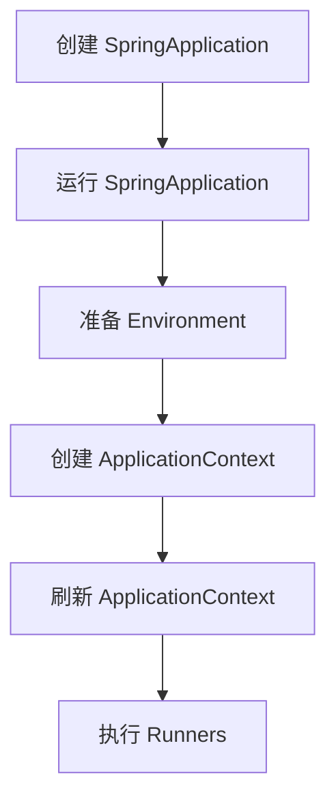

# In-Depth Analysis of Spring Boot Principles

As a framework that simplifies Spring application development, Spring Boot embodies many ingenious design principles. This article explores the core principles of Spring Boot in depth, including auto-configuration, the startup process, and how core annotations work, providing senior developers with comprehensive technical insight.

## 1. Principles of Auto-Configuration

Auto-configuration is one of the most core features of Spring Boot, and it greatly simplifies the application configuration process.

### 1.1 The @EnableAutoConfiguration Annotation

The magic of auto-configuration begins with the `@EnableAutoConfiguration` annotation. Through `@Import`, this annotation introduces `AutoConfigurationImportSelector`, which is responsible for loading auto-configuration classes.

```java
@Target(ElementType.TYPE)
@Retention(RetentionPolicy.RUNTIME)
@Documented
@Inherited
@AutoConfigurationPackage
@Import(AutoConfigurationImportSelector.class)
public @interface EnableAutoConfiguration {
    // ...
}
```

### 1.2 Conditional Configuration

Spring Boot extensively uses the `@Conditional` annotation and its variants (such as `@ConditionalOnClass`, `@ConditionalOnMissingBean`, etc.) to implement conditional configuration.

```java
@Configuration
@ConditionalOnClass(DataSource.class)
public class DataSourceAutoConfiguration {
    @Bean
    @ConditionalOnMissingBean
    public DataSource dataSource() {
        // 配置数据源
    }
}
```

### 1.3 The Auto-Configuration Loading Process

1. Scan the `META-INF/spring.factories` file on the classpath
2. Load the configuration classes corresponding to the `org.springframework.boot.autoconfigure.EnableAutoConfiguration` key in the file
3. Filter the configuration classes that meet the conditions (based on `@Conditional` annotations)
4. Apply the filtered configurations

## 2. Spring Boot Startup Process

The Spring Boot startup process is complex and precise, and it mainly includes the following steps:

1. Create the `SpringApplication` object
2. Run `SpringApplication`
   - Prepare the Environment
   - Create the ApplicationContext
   - Refresh the ApplicationContext
   - Execute runners

### 2.1 Startup Flowchart



### 2.2 Key Source Code Analysis

Below is a simplified version of the `run` method of `SpringApplication`, showing the main startup steps:

```java
public ConfigurableApplicationContext run(String... args) {
    // 1. 创建并启动计时器
    StopWatch stopWatch = new StopWatch();
    stopWatch.start();
    
    ConfigurableApplicationContext context = null;
    try {
        // 2. 准备环境
        ConfigurableEnvironment environment = prepareEnvironment(listeners, applicationArguments);
        
        // 3. 创建 ApplicationContext
        context = createApplicationContext();
        
        // 4. 刷新 ApplicationContext
        refreshContext(context);
        
        // 5. 执行 Runners
        callRunners(context, applicationArguments);
    } catch (Throwable ex) {
        handleRunFailure(context, ex, listeners);
    }
    
    // 6. 停止计时并返回 context
    stopWatch.stop();
    return context;
}
```

## 3. Analysis of Core Annotations

Spring Boot makes extensive use of annotations to simplify configuration and development. The following are some core annotations and how they work:

### 3.1 @SpringBootApplication

This is a composite annotation, equivalent to the combination of `@Configuration`, `@EnableAutoConfiguration`, and `@ComponentScan`.

```java
@Target(ElementType.TYPE)
@Retention(RetentionPolicy.RUNTIME)
@Documented
@Inherited
@SpringBootConfiguration
@EnableAutoConfiguration
@ComponentScan(excludeFilters = {
    @Filter(type = FilterType.CUSTOM, classes = TypeExcludeFilter.class),
    @Filter(type = FilterType.CUSTOM, classes = AutoConfigurationExcludeFilter.class) })
public @interface SpringBootApplication {
    // ...
}
```

### 3.2 @Configuration

Marks a class as a configuration class, equivalent to an XML configuration file.

### 3.3 @Bean

Marks a method as producing a Bean object to be managed by the Spring container.

### 3.4 @Conditional

The core annotation for conditional configuration, which determines whether to create a certain Bean or enable a certain configuration based on specific conditions.

## 4. Practical Tips

1. **Custom Auto-Configuration**: Create your own `@Configuration` class and register it in the `META-INF/spring.factories` file.

2. **Exclude Auto-Configuration**: Use `@EnableAutoConfiguration(exclude = {DataSourceAutoConfiguration.class})` to exclude specific auto-configurations.

3. **Custom Banner**: Create a `banner.txt` file in the `resources` directory to customize the startup banner.

4. **Configuration File Priority**: Understand the priority order of `application.properties`, `application.yml`, and external configurations.

5. **Use Actuator**: Integrate Spring Boot Actuator to monitor and manage the application.

## Conclusion

Through core principles such as auto-configuration, conditional configuration, and annotation-driven development, Spring Boot greatly simplifies the Spring application development process. A deep understanding of these principles not only helps you use Spring Boot better but also enables you to quickly locate and resolve issues when problems arise. As a senior developer, mastering these principles will enable you to customize and optimize Spring Boot applications more flexibly.